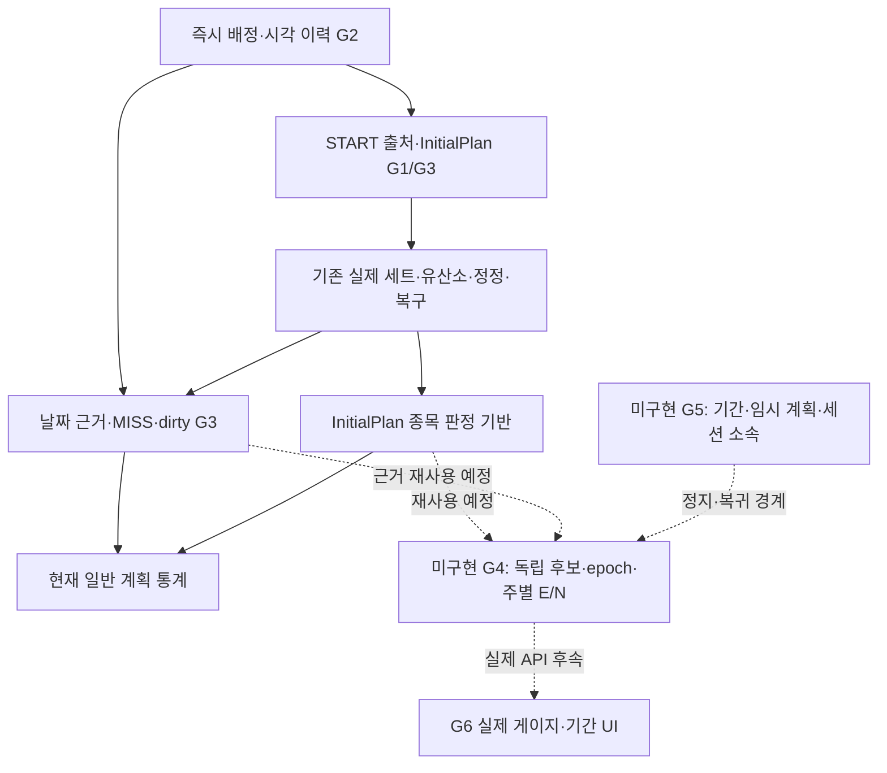

# 디로딩 v1.7 정책 통합·Backend 구현 현황 분석

> **1차 검증 체크포인트.** 최신 다중 프리셋·G5 연동과 최종 회귀 결과는 [Backend 12.5절](../../../overload-server/docs/engineering/backend.md#125-다중-주간-일정-프리셋)에서 확인한다.

## 0. 2026-11-08 1차 개발 최종 현황

Backend 체크포인트 `e9824ba80311`에서 **G0~G5-3 구현을 확인했다.** G6는 시안만 있으며 분석·기간·디로딩 세션 API의 실제 PWA 연동은 후속이다. 격리 스키마 검증과 기존 DB 적용을 구분한다. 아래 1~12절의 미구현 판정, 기술 후보, 테스트 합계, 착수 순서는 **2026-11-07 준비 단계의 기록**이다. 현재 요청·응답·오류는 연결한 API 계약을 사용한다.

| 범위 | 현행 구현과 권위 있는 계약 |
|---|---|
| G0~G3 | 루틴·START/관리 쓰기는 owner 잠금으로 직렬화한다. 일정은 즉시 적용하며 원래 계획·첫 예정 START·최초 MISS를 보존한다. G3는 다음 로컬 날짜 04시부터 확인된 계획만 검사하고 기존 적용 이전 날짜를 소급 판정하지 않는다. [주간 일정 및 일별 검사](../../../overload-server/docs/api/weekly-schedule.md) |
| G4-1~G4-6 | 초기 ON과 OFF→ON을 구분한다. 일반 세션별 불변 InitialPlan과 날짜별 최고 단일 결과를 사용한다. 월요일 04시 이후 확정한 정확한 RESET/ADD/EXCLUDED를 접고, 8주 도달 여부를 분수로 비교한다. 정정·삭제·복구는 입력 revision을 통해 영향 주부터 다시 계산한다. [분석 API](../../../overload-server/docs/api/deload-analysis.md) |
| G5-1~G5-2 | 네 자격과 별도 단일 기간 제약, 출처에 근거한 편성·감량, 독립 임시 계획·세션 소속·최초 수행 표식을 구현했다. 일반 승인과 성장 사건에는 디로딩 실적을 사용하지 않으며 실제 운동량·근육·이력에는 포함한다. [기간·임시 계획 API](../../../overload-server/docs/api/deload-periods.md) · [운동 세션 API](../../../overload-server/docs/api/workout-sessions.md#g5-2-디로딩-세션) |
| G5-3 | 수동·무수행 취소·고정 시간대 10일차 자동 완료, ACTIVE 및 ACK 보호, 종료 이력과 다음 날 일반 운동 복귀를 구현했다. ON 완료는 새 epoch 0주, OFF는 유지, 취소는 같은 epoch를 유지한다. 종료한 보호 날짜는 G3 MISS로 소급하지 않고 G4는 기존 CAS/revision으로 재개한다. [G5-3 구현 보고서](../../../overload-server/docs/tasks/deload-g5-3-report.md) |

**실제 적용 전 확인할 경계.** V25~V29는 격리 DB에서 검증하며 기존 검토 DB의 V24는 이전 확인 기록이다. 기존 계정 이행은 자동으로 실행되지 않는다. 해당 계정의 신규 일반 START와 일정 저장도 설정 부재 시 실패하므로, 대상 계정·세대·비소급 `T_adopt`·실행 방법을 적용 전에 검증하고 승인받는다. 기존 PWA 세션 검증기는 `InitialPlan.routineId`가 UUID여야 한다. 서버 디로딩 세션은 이 필드가 null이므로, G6 전에 디로딩 세션이 섞이면 일반 상세/ACTIVE 조회가 응답을 거절할 수 있다. 이는 소스 병합과 별개의 배포 제약이다. [현재 PWA 검증기](../../src/features/workout-online/validation.ts)

**최종 검증.** Backend 캐시 제외 실행은 단위 432건, Testcontainers 통합 816건과 assemble을 통과했다. V24→V29를 같은 격리 DB에서 순차 적용하며 기존 행, 봉인 평가, InitialPlan·적용 계획·snapshot hash, 승인 중량·사건, 수행·정정·일별 판정과 Flyway 체크섬을 비교했다. 기존 계정 이행은 실행되지 않았다. PWA 테스트 548건과 build·lint도 통과했다. 혼재 fixture에서는 일반 세션 상세가 통과했고 디로딩 상세와 ACTIVE가 `RESPONSE_INVALID`로 거절됐다. 실제 검토 PostgreSQL에는 접속하지 않았으며 컨테이너·볼륨, 기존 서버 PID와 시작 시각, 백업 4개 및 V1~V29 파일 해시가 시작 전과 같았다.

**병합 사전 점검.** 두 로컬 main은 각각 feature의 공통 분기점이다. 이 상태에서는 fast-forward가 가능하다. PWA 변경 범위에는 T02-B 루틴 목록·폼·태그·웨이트/유산소 관리, 주간 일정 편집과 홈 상태 연동, 검토 전용 경로, UI 명세·와이어프레임·테스트가 들어간다. G6 코드와 실제 DB 적용은 포함되지 않는다. 병합과 원격 반영은 실행하지 않았다.

### 2026-11-07 준비 당시 기록

2026-11-07 (Asia/Seoul). 기능 개발이 아닌 소스·계약·테스트·보존 환경의 현황 분석이다. G0~G3 기반은 구현되어 있지만 **G4 분석 엔진·G5 실제 디로딩 실행 엔진은 미구현**이다. 재사용 가능한 일반 기능을 실제 디로딩 구현으로 계산하지 않는다. 최초 분석과 문서 정정 커밋은 아래에 기록했다. 후속 요청으로 신규 계정 기본ON을 확정 반영하고5절의 G4 준비 계약을 구체화한다. **이번 준비 작업은 문서만 수정하며 commit/push·기능 소스·migration·DB·서버 변경은 하지 않는다.**

## 1. 기준·Git 체크포인트·조사 범위

| 대상 | 확인한 기준 |
|---|---|
| PWA UI 구현 | `85ec10f50e595467622f1f562c1430e1896baf24` |
| 이번 1단계 UI 문서 커밋 | **`6b13ff8167ebed4ebf575032837fc4666173c4f6`** / `docs: synchronize T02-B UI specifications and wireframe` |
| Backend | `2d37f8b7ce0445d5246ba47e8a37dac227372cdc` |
| 이번 G4 준비 시작 HEAD | PWA `00622559e9ee845b2d4d65643e0a88a5f719c267`, Backend `eb193cbf3956381a0188f7796fca3eb69fcfa16c`; 양쪽 clean 확인. 위 해시는 당시 분석 기준 |
| 양쪽 브랜치 | `feature/weekly-schedule-daily-review-t02b` |
| 현행 디로딩 정책 | [v1.7](../product/Overload_Deloading_Design_Specification_v1.7.md) |
| 보존 정책 원본 | [v1.6](../product/Overload_Deloading_Design_Specification_v1.6.md), Backend의 [v1.3](../../../overload-server/docs/product/Overload_Deloading_Design_Specification_v1.3.md) 및 이전 버전 |
| 일반 통계 정책 | [통계·추적 v1.4](../../../overload-server/docs/product/Overload_Statistics_and_Tracking_Design_Specification_v1.4.md), 특히 ST-12/15/17~23 및14절 |
| 설계·단계 기록 | [최종 구현 계획](../../../overload-server/docs/tasks/weekly-schedule-immediate-implementation-plan.md), [G0~G1 보고서](../../../overload-server/docs/tasks/weekly-schedule-g0-g1-report.md), [초기 통계·디로딩 조사](../../../overload-server/docs/tasks/statistics-deload-phase-0-1-report.md) |
| UI·PWA | [Decision Log](../product/Overload_UI_Decision_Log_v0.9.md)10.12/10.14 및 디로딩 정정10.15, [현재 HTML](../product/Overload_UI_Baseline_Wireframe_v0.9.html), [Theme Spec](../product/Overload_UI_Visual_Theme_Spec_v0.9.md), [Frontend8.7절](../engineering/frontend.md#87-v09-적용-범위와-구현-상태) |
| 엔지니어링·원본 보호 | 양쪽 AGENTS.md, [Backend 규칙](../../../overload-server/docs/engineering/backend.md), [Task009 v1.0](../../../overload-server/docs/tasks/task-009-redesign-v1.0.md), [세션 계약](../../../overload-server/docs/api/workout-sessions.md) |

이전 보고서의 당시 예약/미구현/테스트 합계를 현재 구현으로 복사하지 않았다. 현재 Java·SQL·DTO·테스트 소스와 로컬 JUnit XML을 직접 대조했다. 새 패키지·migration·기능 코드는 만들지 않았고 실제 미수행 작업을 호출하지 않았다.

### 1.1 UI 보존본 공백의 좁은 예외

1단계의 12개 staged 파일만 커밋했다. 수정 전 `85ec10f:docs/product/Overload_UI_Baseline_Wireframe_v0.9.html`, 새 보존본의 인덱스 blob, 필터 없는 파일 blob은 모두 **`f42a8e1835723972a89c9b57098e74b22a03111f`**다. 정규화 비교만이 아니라 Git blob/실제 파일 바이트가 일치했다.

원래 `git diff --cached --check`의 오류는 보존본365행 `trailing whitespace` **정확히1건**이었다. 원본은 수정하지 않았다. 다른 파일은 다음과 같이 정상 검사했고 exit0이었다.

```text
git diff --cached --check -- . :(exclude)docs/product/Overload_UI_Baseline_Wireframe_v0.9_before_T02B_2026-11-07.html
```

해당 pathspec 인수는 실제 실행에서 별도 인수로 전달했다. 전역/로컬 Git whitespace 설정·hook·다른 파일 예외를 추가하지 않았다. 12개 문서 외 소스·로그·캡처·백업·환경/인증 파일은 포함하지 않았고 commit 직후 PWA는 clean이었다. push·amend·rebase·reset은 수행하지 않았다.

## 2. 정책 통합 결과

상세 DL 식별자별 추적은 v1.7의15절이 단일 기준이다. 기존 **DL-01~90 전부**를 유지했고 감량·편성 규칙의 숫자를 임의로 재작성하지 않았다.

| 항목 | 유지·수정·폐기 |
|---|---|
| 철학·표시 | 직접 피로도 측정이 아닌 실제 일반 수행 기반의 간접 훈련 주기. 목표8주·비강제·완전휴식 유지. 주중 가산 없이 마지막 확정 게이지 표시 |
| 분석 ON/OFF | OFF는 디로딩 분석만 중단. 일반 기록·G3·통계 유지. 재ON은 새 epoch/0, 진행 기간은 토글과 독립 |
| 하루 값 | InitialPlan 종목 완료 기준 유지, 추가종목 제외·최고 단일 세션 유지. 예정 외/휴식일의 일반 세션도 자기 InitialPlan으로 평가하도록 후보 확대 |
| 주간 값 | 계획일 분모 폐기. 실제/확정MISS의 distinct 날짜 N·유효값 E. E≤1 RESET, E>1 min(1,E/N) ADD. 다음 월04시/일별 검사 완료 뒤 확정 |
| 일정·과거 | 다음 월요일 예약 폐기·즉시 적용. 현재 템플릿 변경으로 과거를 재분류하지 않음. 늦은 원본 정정에 따른 파생 재평가는 별개 |
| RESET·epoch | 주간 RESET은 가역 파생값, 재ON·정상/자동완료는 hard 경계. 정정 시 영향 주 이후 같은 epoch를 순서대로 다시 계산 |
| 시작 자격 | 계획≥2일 조건 폐기. 최근7일 실제 일반 수행/이전 완료 이후 새 수행/오늘 수행 없음/ACTIVE 일반 세션 없음의4조건 |
| 기간 | 권장7·최대10·7일 자동종료 없음·10일차 종료 자동완료·언제든 직접완료·완료 다음날 복귀 유지. 실제 수행이 한 번도 없을 때만 취소·누적 보존 |
| 편성·감량 | 원본 빈도 초과 압축 금지, PPL/전후면/균등, PRIMARY·원순서 메인·다관절 정렬·커버·상한·라운드로빈, 중량85%·세트50%·홀수 반복·유산소 감량/배치 등 유지 |
| 기록·권한 | 실제 디로딩 운동량/이력 포함, 일반 승인·증감 평가 제외. 기간 소속·최초 계획·원승인·오프라인 원본 보호·일반 보기 읽기 전용 유지 |

ST-17~23의 일반 계획 이행률과 디로딩 후보는 분리한다. PUSH 예정일에 PULL을 전부 수행하면 일반 PUSH 달성률은0이지만 디로딩은 PULL 자기 InitialPlan으로1이다. 같은 날짜 최초 MISS와 실제 수행을 N2로 세지 않는다. UNKNOWN은 실패0으로 바꾸지 않는다.

## 3. 실제 Backend 구조와 구현 판정

Java25/Spring Boot4.1.2, Spring Data JPA+JdbcTemplate, 동일 `workoutTransactionManager`, PostgreSQL/Flyway, JUnit/Testcontainers 구조다. HTTP 인증·CSRF·principal·소유권·dataGeneration 경계는 기존 계약을 사용한다. 일정·통계·세션은 기능별 패키지이고 디로딩 전용 패키지는 없다.



| 영역 | 판정 | 실제 근거·한계 |
|---|---|---|
| G0 현재 계약 | 구현 및 테스트 확인 | `WeeklyScheduleRequests`/DTO/Controller, Routine·세션·통계 계약 존재. immediate-v1 전환 마커·형식·세대/version·CSRF 등. G4/G5 DTO·DDL까지 확정됐다는 뜻은 아님 |
| G1 START/관리 경합 | 구현 및 테스트 확인 | START·관리 쓰기 owner FOR UPDATE/READ_COMMITTED, 실제 원본 구성/삭제·일정 변경409. 승인·이름/태그·no-op·운동 내부 쓰기는 별도 유지 |
| G2 즉시 일정·이력 | 구현 및 테스트 확인 | version/appliedAt/assignments, V24 경계·recorded_at/동일 시각version정렬, 역행 거부·삭제의 즉시 배정 제외·이력 보존 |
| G3 일별 판정 | 구현 및 테스트 확인 | 04시 due·최초 START/MISS 근거·PERFORMED/MISSED/PENDING_ACTIVE/UNKNOWN/EMPTY·dirty/retry/cursor·분할 배치·재시작/동시성 |
| G4 분석 설정/epoch | **미구현·문서만 존재** | UserWorkoutSettings는 휴식초뿐. 분석 토글/활성구간/epoch 저장·API 없음 |
| G4 독립 후보/주간 E/N | **미구현**, 종목 판정·날짜 근거 재사용 가능 | 현재 PlanningCalculator는 예정 루틴만. 주별ADD/RESET·월04시 publication·revision/누적재계산 저장·API 없음 |
| G5 기간/임시 루틴/자격/종료 | **미구현**, 공통 카탈로그/세션/동기화 재사용 가능 | 기간·임시 계획·소속·권한·감량/편성·4조건 자격·10일 완료·취소 수행사실 없음 |
| G6 분석/기간 PWA | **표현 기반 일부 구현**, 실제 연동 미구현 | 공식 달·Onyx/Mint 토큰·개발용 헤더 시안은 있음. 실제 분석/기간 API·디로딩 START·임시 일정·완료/취소 연결 없음 |

`src/main`·`src/test` 전체에서 deload/epoch/period 계열 책임을 검색했다. deload 언급은 성장 Repository의 “향후 디로딩이 일반 승인 사건을 만들면 안 됨” 주석뿐이었다. 최신 migration은 V24이며 디로딩 저장소가 없는 것과 실제 DB 적용 여부를 별도로 확인했다.

### 3.1 코드·DB 모델·주요 함수 근거

아래 Java 기본 위치는 `overload-server/src/main/java/com/overload/overload_server`다.

| 파일/주요 함수 | 확인한 실제 책임 | G4/G5에 대한 재사용·부족 |
|---|---|---|
| [WorkoutSessionService](../../../overload-server/src/main/java/com/overload/overload_server/workoutsession/WorkoutSessionService.java) `start`, [Repository](../../../overload-server/src/main/java/com/overload/overload_server/workoutsession/WorkoutSessionRepository.java) `lockOwnerForStart` | owner 잠금 후 최신 원본 복사, 같은 UUID START 재확인, `calendars.origin/recordStart`, 기존 단일ACTIVE/만료 처리 | 새 디로딩 시작·일반 START 차단을 같은 경합 경계에 넣어야 함. 아직 기간/세션 유형 검사 없음 |
| [RoutineService](../../../overload-server/src/main/java/com/overload/overload_server/routine/RoutineService.java) `update` 구성 비교, [RoutineRepository](../../../overload-server/src/main/java/com/overload/overload_server/routine/RoutineRepository.java) `requireEditableSource` | ACTIVE 원본의 실질 변경만 차단. 승인/메타/no-op 분리. 삭제·이력 쓰기 원자 처리 | G5의 ACTIVE 기간 중복 생성 차단은 네 운동 자격과 별도 상태 제약이다. 기간 중 일반 보기 read-only는 더 넓은 정책이며 현재 ACTIVE guard로 대체 불가 |
| [WeeklyScheduleService](../../../overload-server/src/main/java/com/overload/overload_server/routine/WeeklyScheduleService.java) `save/view/history`, [Requests](../../../overload-server/src/main/java/com/overload/overload_server/routine/WeeklyScheduleRequests.java) | 현재 배정 즉시 저장, expectedVersion·세대/시간대·ACTIVE·no-op, 저장 후 scope DTO, history20개 | 디로딩 임시 일정은 일반 배정을 덮지 않고 독립 기간에 연결해야 함 |
| [RoutinePlanHistory](../../../overload-server/src/main/java/com/overload/overload_server/routine/RoutinePlanHistory.java) `record/removeFromSchedule` | 버전별 불변 계획·시각 검증·삭제시 즉시 새배정, owner 잠금 참여 | 과거 판정/편성 출처 재사용. 과거 근거를 현재 루틴으로 교체하지 않음 |
| [WorkoutCalendarRepository](../../../overload-server/src/main/java/com/overload/overload_server/routine/WorkoutCalendarRepository.java) `control/origin/recordStart` | 경계 version·시간대·reviewFrom/cursor와 START 당시 일정 출처·첫 예정 START 고정 | 검사 메타데이터이며 분석 설정/epoch 아님. 미등록 계정은 control이 없을 수 있음 |
| [V24 SQL](../../../overload-server/src/main/resources/db/migration/V24__immediate_weekly_schedule_and_daily_review.sql) | 일정 월요일제약 제거·범위index·최신 저장 의도 승격, nullable 불변 schedule_version_at_start, daily 테이블·dirty trigger | 신규 디로딩 테이블/열 없음. 기존 migration 수정·재실행 없이 후속 DDL 설계 |
| [DailyTrainingReviewService](../../../overload-server/src/main/java/com/overload/overload_server/statistics/DailyTrainingReviewService.java) `dueDate/reviewBatch/review`, [Job](../../../overload-server/src/main/java/com/overload/overload_server/statistics/DailyTrainingReviewJob.java) | 기본60초/20owner/31일창, owner SKIP LOCKED, 04시·dirty/10분retry·cursor, 무수행 휴식 영구REST행 안 만듦 | 같은 job의 주별 호출 확장 가능. 현재 주별 확정·epoch·기간정지 검사는 없음 |
| [PlanningRepository](../../../overload-server/src/main/java/com/overload/overload_server/statistics/PlanningRepository.java) `read` | 구 effective_from/신 recorded_at 경계와 frozen START/MISS·루틴 버전·ACTIVE/dirty 조회 | UI history20개와 분리된 판정 SQL 재사용. 일반 예정 근거와 디로딩 후보 근거의 UNKNOWN은 별도 판단 |
| [PlanningCalculator](../../../overload-server/src/main/java/com/overload/overload_server/statistics/PlanningCalculator.java) `calculate/firstStart/judge/Fraction` | 예정 루틴만 후보·각자 InitialPlan·최고 단일·정확분수·미확인 유산소 하한/상한 | `judge`/Candidate는 private이며 G4 소비가 생길 때 작은 공유 함수로 추출/노출. `calculate` 결과 effectiveDay를 디로딩 값으로 복사하면 안 됨 |
| [StatisticsRepository](../../../overload-server/src/main/java/com/overload/overload_server/statistics/StatisticsRepository.java) `read`, [Service](../../../overload-server/src/main/java/com/overload/overload_server/statistics/StatisticsService.java) `overview` | 종료·미삭제 세션, 유효 실제 세트/COMPLETED 유산소, immutable 날짜, 일반 계획일 분모/통계 집계 | 수행 사실·세트/유산소 조회 재사용. ACTIVE를 제외하고 기간/일반 유형 필터는 아직 없음 |
| [WorkoutSession](../../../overload-server/src/main/java/com/overload/overload_server/workoutsession/WorkoutSession.java), [InitialPlan](../../../overload-server/src/main/java/com/overload/overload_server/workoutsession/InitialPlan.java) | sourceRoutineId 필수, schema2 최초 JSON·시작날짜/시간대·소유권·writerEpoch | deloadPeriodId/일반·디로딩 소속 필드 없음. 임시 원본의 저장/START 계약을 실제로 설계해야 함 |
| [SnapshotService](../../../overload-server/src/main/java/com/overload/overload_server/workoutsession/WorkoutSnapshotService.java) `save/applySnapshot/finish/resolve/resolveClosed`, [RecordService](../../../overload-server/src/main/java/com/overload/overload_server/workoutsession/WorkoutRecordService.java) `edit/recover/assessment`, [WorkoutAssessment](../../../overload-server/src/main/java/com/overload/overload_server/workoutsession/WorkoutAssessment.java) | 고정 요청/hash·ACK·종료 최초평가·현재평가·승인해결·정정·논리삭제·명시복구 | 일반 승인평가를 디로딩에 연결하지 않도록 모든 쓰기/사후 경로에 불변 소속 검사 필요. 기존 승인 평가 eligible은 InitialPlan 종목 완료와 다름 |
| [StandardExercise](../../../overload-server/src/main/java/com/overload/overload_server/catalog/StandardExercise.java), V18/V23·카탈로그 Repository | jointType COMPOUND/ISOLATION/OTHER, null 미분류; PRIMARY/SECONDARY·카디오 카탈로그·장비/중량 데이터 존재 | 자동 분할/대표 선정/감량 엔진은 없음. 분류 컬럼 존재가 운영 분류품질 완료를 뜻하지 않음 |
| [UserWorkoutSettings](../../../overload-server/src/main/java/com/overload/overload_server/workoutsettings/UserWorkoutSettings.java) | rest_low/medium/high_seconds와 버전 | 분석/epoch/cursor를 휴식 설정에 섞을 근거가 없음 |

### 3.2 G3와 G4의 중요한 차이

G3 PERFORMED는 “실제 수행 있음”이다. 최초 계획 종목을 하나도 완성하지 못한1세트도 PERFORMED이며 날짜의 유효값은0일 수 있다. PERFORMED를1로 변환하면 안 된다. REST인 날짜의 실제 수행도 G3는 보존하지만 현재 일반 overview의 effectiveDay는0이다. 이것을 G4가 그대로 쓰면 휴식일 후보를 놓친다.

V24 source trigger는 실제 세트·유산소·상태/논리삭제 변화와 같은 transaction에서 revision을 늘리고 dirty를 켠다. GET·고정 ACK/no-op에는 새 사실을 만들지 않는다. G4는 이 입력 revision/dirty를 이용해 주 평가를 깨워야 하며 별도의 동일 목적 일별 데이터/Outbox/feed를 추가하지 않는다. 현재 Job에는 G4 호출이 없으므로 이 재사용 가능성을 “주별 재평가 구현됨”으로 보고하지 않는다.

현재 `judge`는 실제 속도와 시간/거리 목표를 비교하고, 목표 경사/저항이나 필요한 측정 근거가 없으면 UNKNOWN을 보존한다. G4가 이를 임의 완료로 바꾸지 않는다. `Fraction.decimal()`의12자리 반올림은 표시용이며 E≤1 판정·후속 누적의 입력값으로 재사용하지 않는다.

현재 G3 Job의 owner 탐색은 `workout_calendar_control`을 기준으로 한다. 반복 일정 미등록/계획0인 계정의 실제 일반 운동도 G4 후보이므로 분석 활성 계정을 기존 control 유무만으로 누락시키지 않는 탐색·시간대 계약이 필요하다. 이를 위해 가짜 휴식 일정을 등록하지 않는다.

## 4. API 준비 상태

| 소비 책임 | 실제 존재 | 부족한 계약 |
|---|---|---|
| 일반 루틴/일정·통계 | `/api/v1/routines`, `/api/v1/weekly-schedule`, `/api/v1/statistics/overview` 및 이력/성장·카탈로그 | G4 주간 E/N·분석epoch·누적을 일반 계획 달성률로 대체 불가 |
| 분석 ON/OFF·실제 게이지 | 없음 | 실제 활성구간/epoch·expectedVersion·상태/미확정·마지막 확정값·8주 도달 조회/저장 |
| 시작 자격 | 없음 |4조건별 허용/차단 이유와 최종 재검증, 기준 시각/시간대·현재 세대·ACTIVE/알려진 로컬 원본 |
| 미리보기/시작 | 없음 | 원본 버전·선택 횟수/분할/요일·감량 대비·미리보기와 확정 사이 변경 거부·중복 시작 방지 |
| 기간/임시 계획/일정 | 없음 | 기간 version·임시 계획 소속·미수행 수정/교환/삭제·일반 read-only 정책 |
| 완료/취소/자동 종료 | 없음 | 종료 시각·사유·10일 경계·누적reset/preserve·ever-performed·ACTIVE/지연동기화 원자성 |

신규 계정의 **기본ON·누적0·초기 epoch**는2026-11-07 사용자 추가 결정으로 확정됐다. 최초 ON은 OFF→ON이 아니며 HTML 초기ON/개발 시안과 실제 서버 상태는 구분한다. 기존 미설정 계정의 비소급 이행·API/DDL 후보는5절을 따른다. 후보 경로·DTO·오류는 구현 전 기술 계약이며 현재 존재하는 API로 선언하지 않는다. 기존 AuthApi/WorkoutTransport·쿠키/CSRF·code-only 오류·scope/version·no-store를 재사용할 수 있다. 새 API가 필요하다는 정책과 실제 breaking 변경/DB 적용 승인은 구분한다.

PWA [HomePanel](../../src/features/home/HomePanel.tsx)은 일반 계정에서 분석 미연동 아이콘을 표시한다. [HomeReviewContext](../../src/review/context.ts)·[ReviewHeader](../../src/review/ReviewHeader.tsx)의5.2주는 개발 표시이며 서버 상태·권한·통계/IndexedDB에 저장되지 않는다. 실제 게이지·분석 토글·기간 UI는 G4/G5 API 이후 별도 G6 작업이다.

## 5. G4 개발 범위·의존성·검증 계획

기존 C+A 최소 확장 방향을 유지한다. 이 절은 **구현 전 기술 후보와 실행 기준**이며 새 서비스·API·테이블은 아직 없다. 제품 E/N·네 자격·OFF/epoch는 다시 설계하지 않는다. 실제 SQL/DTO·오류명은 G4-1에서 검증하며 기능 개발은 별도 지시 후 진행한다.

### 5.1 실제 코드 대조와 재사용

| 실제 근거 | 재사용 및 필요한 확장 |
|---|---|
| [AccountProvisioningService.provision](../../../overload-server/src/main/java/com/overload/overload_server/account/AccountProvisioningService.java), [AccountRepository](../../../overload-server/src/main/java/com/overload/overload_server/account/AccountRepository.java) | users/identity/휴식 seed는 같은 REQUIRES_NEW·READ_COMMITTED JDBC 트랜잭션, identity 경쟁 패자는 전체 rollback 후 승자를 읽는다. 신규 생성 경로에 분석 초기 행을 함께 넣고 재로그인에서는 재seed하지 않는다 |
| [V1 users](../../../overload-server/src/main/resources/db/migration/V1__create_users.sql), [UserWorkoutSettings](../../../overload-server/src/main/java/com/overload/overload_server/workoutsettings/UserWorkoutSettings.java) | created_at·data_generation은 있으나 계정 공통 시간대·분석 필드는 없다. 휴식 @Version은 분석 expectedVersion을 대신하지 않으며 별도 휴식 계약은 유지한다 |
| PlanningCalculator.judge/Candidate/Fraction | private 종목 판정·하한/상한·BigInteger 분수만 최소 공유한다. 일반 calculate의 예정 루틴 필터/일정 분모/PlannedDay까지 공통화하지 않는다. ST-17~23과 기존 테스트 유지 |
| StatisticsRepository.read·PlanningRepository.read | 미삭제 FINISHED/AUTO_CLOSED·실제 WEIGHT 세트·COMPLETED 유산소·InitialPlan을 재사용한다. 현재 Session projection에는 started_at/started_time_zone가 없으므로 epoch 구간 필터용 메타 조회가 필요하다. G4에 불필요한 근육 매핑/최근3건을 매번 읽지 않게 필요한 사실 조회만 공유한다 |
| DailyTrainingReviewService/Job·WorkoutCalendarRepository·V24 | 04시 due·dirty/revision·retry·잠금·분할 배치 재사용. PERFORMED는 점수1이 아니다. 현재 owner 탐색은 calendar_control만 사용하므로 일정 없는 분석 계정 탐색이 필요하다. cursor는 보류 날짜도 지나가므로 단독 확정 근거가 아니다 |
| WeeklyScheduleService·WorkoutSessionRequests·SecurityConfiguration | owner FOR UPDATE·세대/expectedVersion·IANA ZoneId·START 날짜 검증과 세션/CSRF/code-only/no-store 재사용. 기존 START 입력·고정 hash·불변 날짜는 바꾸지 않는다 |

### 5.2 초기 ON과 기존 미설정 계정의 이행 후보

**신규 생성:** 계정 생성 트랜잭션에서 `(owner,generation,version=0,epoch=0,enabled=true,reason=INITIAL)` 한 행을 생성한다. epoch 기준 시각은 같은 users.created_at을 서버에서 읽고 최초 누적은 정확한0이다. 최초 GET/로그인/클라이언트 시각으로 바꾸거나 OFF→ON 사건을 만들지 않는다. identity 경쟁 패자·가입 실패는 분석 행도 함께 rollback한다. 초기 PK와 기존 identity 유일성으로 동시 최초 요청에 epoch 하나만 남긴다.

**시간대:** 현재 가입 계약에는 시간대가 없다. ON/초기 epoch 시각은 가입과 함께 보장하고 time_zone 미확정 동안 계산 상태는 `AWAITING_TIME_ZONE` 후보로 구분한다. 설정ON·초기누적0은 유지하되 미확정 주간 점수를0으로 확정하지 않는다. 기존 일정이 있으면 고정 시간대를 재사용한다. 일정 없는 계정은 최초 일반 START의 검증된 startedTimeZone 또는 인증된 명시적 설정 쓰기의 IANA 시간대로 한 번 확정하는 방안을 사용한다. version만 증가하고 초기 epoch 시각은 유지한다. 일정 최초 저장/START/설정 쓰기와 같은 owner 잠금에서 일관성을 확인하며 이후 다른 기기 시간대로 과거 workoutDate를 다시 쓰지 않는다. JVM 기본 UTC를 조용히 대입하지 않는다. 시간대 혼재·경합은 격리 테스트로 검증한다.

**기존 미설정 계정:** 현재 분석 설정 구조 자체가 없으므로 기존 계정은 신규 가입 경로와 구분해야 한다. 이행 후보는 후속 DDL 배포 시 가입/관리 쓰기 정지·백업/격리 복원 검증 후 고정 서버 시각 `T_adopt`에서 기존 미설정 owner/현재세대에 `enabled=true,version=0,epoch=0,reason=ADOPTED_INITIAL,epoch_started_at=T_adopt`를 한 번 삽입하는 방식이다. 이는 기본ON의 **비소급 이행 제안**이며 이번에 실제 계정을 변경한 것이 아니다. 이미 생성된 ON/OFF 선택은 덮어쓰지 않는다. 기존 계정의 users.created_at으로 소급하지 않고 T_adopt 이전 START/기록/MISS는 가산하지 않는다. 시간대가 없으면 명시적 확정을 기다린다. 재실행은 PK/기존 행 확인으로 중복 초기 epoch를 만들지 않아야 한다.

**부재·재진입:** 이행 후 재로그인/GET은 설정을 재생성하지 않는다. 배포 후 신규 생성 경로의 행 누락은 무결성 오류이며 “부재=신규”로 추정하거나 GET에서 silent seed하지 않는다. 이행 대상·경계를 증명할 수 없으면 자동 복구/소급하지 않는다. 현재 dataGeneration만 다루고 향후 데이터 초기화/세대 전환은 별도 원자적 생성 계약과 연결하며 이전 세대를 복사하지 않는다.

**토글:** 기술 후보에서 epoch 식별자는 그 구간을 연 최초 설정 version이다. 최초 ON은 version0/epoch0, ON→OFF는 동일 epoch의 분석 종료 경계, 실제 OFF→ON은 새 설정 version을 새 epoch로 참조하고 서버 전환 시각·누적0으로 시작한다. epoch에 별도 순번 카운터를 중복 저장하지 않는다. 같은 enabled·확정 시간대 반복은 새 epoch/설정 이력을 만들지 않는다. 미확정 시간대의 최초 확정은 문맥 변경이므로 version만 증가하며 epoch는 유지한다. OFF에는 주간 재계산을 가산하지 않고 재ON이 이전 OFF/epoch 실적을 가져오지 않는다. 시작 시각이 ON 구간에 속한 세션만 후보이며 활성화 전 세션을 쪼개 넣지 않는다. OFF가 일반 진행 세션의 snapshot/FINISH를 차단하거나 미전송 원본을 버리게 하지 않는다.

### 5.3 API·DDL 최소 후보

아래 경로·필드·오류는 **미구현 후보**다. 기존 휴식 API와 분석 계약을 분리하고 시작 자격/기간은 G5로 남긴다.

| API 후보 | 최소 계약 |
|---|---|
| GET `/api/v1/deload-analysis` | 인증 principal의 현재세대 설정·version/epoch/epochStartedAt·timeZone·계산 상태, 마지막 확정 누적 분수/표시값·확정 범위·재계산 시작 주/기준 revision. 본문/미지원 query 거절·일관된 read-only snapshot·no-store. 부재를 성공 기본ON 응답으로 꾸미거나 GET에서 쓰지 않음 |
| PUT `/api/v1/deload-analysis/settings` | `{dataGeneration:Counter,expectedVersion:Counter,enabled:boolean,timeZone:IANA}` 후보. userId/epoch/누적/기준시각은 입력받지 않음. 세션 쿠키+CSRF, owner FOR UPDATE 후 현재세대/version/고정 시간대 확인. 실제 전이만 서버 시각으로 append하고 최신 설정/계산 상태 응답 |

Counter는 기존 정규 long 십진 문자열이다. 형식/중복 키/null/미지원 필드·시간대400, 인증401, CSRF/권한403, 세대/version/시간대409, 연결 일시 실패503 경계를 따른다. 새 code명은 구현 시 테스트와 확정한다. 휴식 API에 expectedVersion이 없다는 이유로 G4에서 생략하지 않는다. expectedVersion은 no-op보다 먼저 확인한다. ACK 유실 후 옛 version 재요청은409→GET 재확인이며 재전이하지 않는다. 최신 version으로 같은 상태를 쓰면 no-op이다. owner 잠금·version PK/같은 트랜잭션으로 동시 최초 시간대 확정·토글·중복 요청을 처리하고 별도 receipt/event 표를 추가하지 않는다. 저장 시각 정밀도·단조 version을 유지하고 시각 역행/overflow는 충돌로 거절한다.

| 저장 책임 후보 | 최소 필드·제약 |
|---|---|
| `deload_analysis_versions` | `(user_id UUID,data_generation BIGINT,version BIGINT)` PK·users scope FK, enabled BOOLEAN, epoch BIGINT, recorded_at/epoch_started_at TIMESTAMPTZ, time_zone TEXT nullable(초기 미확정만), reason TEXT. epoch는 그 시작 행의 version을 참조하는 같은 owner/세대 자기 FK,0≤epoch≤version·시각/시간대 제약. 최신 version으로 현재 설정 조회. 별도 current 설정/epoch/누적 표 없음. related_period는 G5 때 실제 기간과 연결 |
| `deload_weekly_assessments` | `(user_id,data_generation,epoch,week_start DATE)` PK·versions의 해당 epoch 시작 version에 대한 owner/세대 범위 FK. E와 기여의 정확한 분자/분모 NUMERIC 정수, N INTEGER 0~7, rule_version·주별 revision·입력 revision 식별값, 보류/확정·RESET/ADD, confirmed_at/updated_at·재검사 표지. 월요일/양의 분모/0≤E≤N·ADD≤1·N0 나눗셈 금지 검사. 보류값을 확정 점수로 사용하지 않음 |

epoch가 가리키는 행은 최초ON/재ON 등 구간 시작 사건이어야 하고, 이후 OFF/시간대 확정 행은 이를 유지한다. FK와 같은 트랜잭션의 전이 검증으로 다른 owner/세대/epoch가 섞이지 않게 한다. 정확 분수는 기약형 임의 정밀 정수로 저장·문자열 전송하고 NUMERIC 한계/연산 비용을 검증한다. Fraction.decimal은 표시용이다. 마지막 확정 누적은 같은 epoch의 주들을 순서대로 RESET/ADD fold해 구하며 current-total 캐시는 두지 않는다. 가장 이른 dirty/보류 주 이전의 신뢰 가능한 확정값·범위와 재계산 상태를 따로 반환한다. 초기 주간 결과 없음의0과 UNKNOWN을 구분한다. 분할 진도는 주별 상태/revision을 사용하며 중복 일별 점수·범용 작업 이벤트 저장소를 만들지 않는다.

### 5.4 독립 후보·04시 확정·재계산

1. 현재 owner/세대·ON 구간 started_at의 **일반** 세션만 읽는다. 현재는 디로딩 소속 필드가 없으므로 기존 일반 세션 기반 G4 단독 범위와 G5 이후 명시적 소속 필터를 구분한다. 미삭제 FINISHED/AUTO_CLOSED에 실제 WEIGHT 세트 또는 유효 COMPLETED·activeMs>0가 필요하다. START만은 제외하며 부분 수행의 값0은 유효 후보다.
2. InitialPlan 웨이트 계획 세트 전부·유산소 최초 목표를 기존 judge로 판정한다. 실제 활동 존재와 목표 달성은 다르며 추가 종목은 완료 분자에서 제외한다. 날짜별 lower 최대와 모든 후보 upper 최대를 비교해 UNKNOWN이 최고값에 영향을 주면 보류한다. 알려진 완전1이 있으면 다른 UNKNOWN의 상한이 최고1을 바꾸지 못하는 원리도 유지한다. 손상/계획0을0/0=1로 만들지 않는다.
3. 실제 날짜와 G3의 **현재 확정 MISSED** 날짜의 합집합으로 N을 정한다. 실제 날짜는 최고 단일값을 사용하며 두 세션의 종목 완료를 합치지 않는다. 최초 MISS 이력과 실제가 같은 날짜면 N1이다. PERFORMED→1·현재 계획일 분모·예정 루틴 필터 재사용을 금지한다.
4. 고정 시간대 월~일·다음 월04시를 사용한다. calendar_control이 있으면 cursor와 해당 주 dirty/ACTIVE/UNKNOWN·retry/후보 평가 완료를 모두 확인한다. 일정 미등록 계정은 분석 활성 계정 탐색으로 발견하고 실제 세션·ACTIVE·기존 source revision을 평가한다. **계획 부재가 확인된 경우** 실제 날짜만 쓰며 계획 UNKNOWN을 가짜 MISS로 만들지 않는다. 근거 불명확은 보류다. 가짜 일정/control 등록이나 G3 예정일 판정 복제는 하지 않는다.
5. 기존 Job 주기에 G3 검사 뒤 G4 호출을 연결한다. G3가 처리한 owner만 전달하면 일정 없음·일별 no-op·주간 due·재평가를 놓치므로 **분석 활성/재계산 대상은 독립 조회**한다. 별도 자정/월요일 scheduler는 없다. 현재 review.enabled는 job 전체 제어이며 계정 분석 토글과 연결하지 않는다. OFF여도 G3는 처리한다.
6. 기존 source dirty/revision을 재사용한다. 주별 입력 식별값은 ON 경계/시간대/ruleVersion과 관련 날짜 revision의 정렬된 묶음으로 만들고, G3가 dirty를 지우기 전/같은 트랜잭션에서 영향 주를 표시한다. dirty-clear 후에만 조회하거나 최대 revision 하나만 비교하지 않는다. owner 잠금/주별 CAS 아래 원본 변화와 확정을 직렬화하며 계획 외·휴식일 사실도 읽는다.
7. 정상 검사 완료 N0/E0 또는 E≤1은 RESET0, E>1은 min(1,E/N) ADD다. UNKNOWN/ACTIVE/검사 미완료는 보류이며 RESET하지 않는다. epoch 전/분석OFF/전체 정지를 정상 N0으로 바꾸지 않는다. 주별 PK·입력 revision으로 결과를 교체하고 `currentTotal +=`하지 않는다.
8. 정정·늦은 동기화·논리삭제·명시복구는 가장 이른 영향 주부터 같은 epoch 후속 주를 순서대로 재계산한다. RESET은 가역 파생값이다.3→RESET→ADD1의1이 RESET주0.75ADD로 바뀌면4.75이며1.75가 아니다. 재ON hard epoch를 넘지 않는다. bounded catch-up·다중 worker·실패/재시작에서 미처리 주를 재계산 상태로 남긴다. 원본/InitialPlan/고정 JSON/hash/ACK·최초 MISS는 불변이다.

### 5.5 G4-1~G4-6 실행 순서

| 단계 | 수정 예상 모듈·선행 | 완료 기준 |
|---|---|---|
| G4-1 설정·기본ON·epoch/API·DDL | account 신규 생성 트랜잭션·기존 security/요청 검증, 신규 분석 모듈·후속 migration 후보. 번호는 착수 시 확인 | 초기ON/누적0/초기 epoch 원자 생성, 미설정 계정 비소급 이행·시간대·세대/version/CSRF/no-op·동시성 격리 테스트. 실제 DB 적용은 별도 승인 |
| G4-2 공통 InitialPlan 판정 | PlanningCalculator private judge/Candidate/Fraction 최소 추출 | ST-17~23 결과 불변, 웨이트/유산소/추가종목·UNKNOWN 하한/상한·정확분수 테스트 |
| G4-3 독립 후보·E/N | G4-1/2, 필요한 사실·세션 시각 projection, G3 확정MISS/revision | 예정 외/휴식일/계획없음·부분0·다중세션·MISS+실제N1·UNKNOWN 검증 |
| G4-4 04시 주간 확정 | G4-3, 기존 Job·독립 분석 owner 탐색·주별 PK/revision/잠금 | 월04시 전후/DST·일요일ACTIVE/dirty보류·N0/RESET/ADD·재실행·실패 rollback·재시작 |
| G4-5 후속 주 재계산 | G4-4, 원본 dirty와 같은 트랜잭션의 주별 invalidation | 정정/삭제/복구·지연동기화·4.75 복원·epoch 경계·분할 재계산/중간 실패 재개 |
| G4-6 조회·토글·격리 통합 | G4-1~5, 신규 API/인증/계정·세션/통계 회귀 | 정확분수/마지막 확정범위·보류 구분·OFF 중 G3 유지·동시 토글·미등록 계정 자동발견. 전체 단위/격리 통합·assemble·API/문서 확인 |

G4 단독 완료에 G5의 기간 정지·완료 새 epoch·취소 누적 보존·일반/디로딩 소속 필터를 포함하지 않는다. G5 연결 전 실제 디로딩 혼재/기간 보호가 완료됐다고 표시하지 않는다. G6 PWA 실연동·iPhone 검토도 별도다.

### 5.6 필수 격리 테스트 예상 결과

아래는 **미실행 계획**이다. 기존 단위/Testcontainers fixture를 확장하며 검토/개인DB에서 실행하지 않는다.

| 시나리오 | 예상 결과 |
|---|---|
| 신규 가입·재로그인 | 기본ON·누적0·version0/epoch0·INITIAL 한 번, 재로그인으로 설정/version/epoch 변경 없음 |
| 동시 최초 가입·identity 경쟁/중간 실패 | users/identity/휴식/분석 함께 commit 또는 rollback, 초기 epoch 하나·고아 행 없음 |
| 최초 ON vs OFF→ON | 최초 사건과 전환 구분, 재ON은 새 시작 version의 epoch·새 기준 시각·0, OFF/활성화 전 실적 제외 |
| 동일 enabled·ACK 유실·토글 경쟁 | 최신 version 같은 값 no-op, 옛 version409→GET, 중복 epoch/유실 갱신 없음 |
| 기존 미설정 계정 이행/재실행 | T_adopt/ADOPTED_INITIAL·0 한 번, 이전 START/기록/MISS 가산 없음. 기존 선택 보존·불명확 부재 오류 |
| 시간대 없음/충돌·세대/소유권/CSRF | 계산 보류와 ON 구분, 임의 UTC 없음. 검증된 시간대 고정·원본 날짜 불변,400/401/403/409 경계 |
| OFF 중 일반 운동·G3·통계 | 기존 기록/일별MISS/dirty/통계 유지, 분석/추천만 중단. 수동 시작/기간 독립성은 유지하며 실제 G5 연동은 후속 |
| 일정 미등록 또는 계획0일·완전 수행2일 | 가짜 일정 없이 작업 대상 포함, E2/N2=1 ADD |
| 완전 수행1일만 존재 | E1/N1이므로 RESET0,1주 ADD 아님 |
| 부분·미수행 | [1,0.5]→0.75 ADD, [1,1,1,0]→0.75 ADD, [0.5,0.5]→RESET |
| 같은 날 여러 반쪽 세션·MISS+실제 | 합산1 금지, 최고 단일0.5·같은 날짜 N1 |
| 예정 외/휴식일·운동 중 계획 축소 | 자기 InitialPlan 기준, 추가종목 분자 제외·최초 세트 전부 필요·현재 루틴/AppliedPlan 무시 |
| 유산소 양수·목표 미달/근거 부족 | 실제 날짜 포함, 목표 미달0·필요 측정 근거 부족UNKNOWN, START/SKIPPED/무활동 제외 |
| UNKNOWN·일요일 ACTIVE·dirty/retry | 필요한 날짜/최고 후보 미확정이면 보류, cursor 전진만으로 확정 안 함. 완전1이 UNKNOWN 상한을 지배하는 경우 별도 검증 |
| 월03:59:59/월04:00:00·DST | 전자 미가산, 후자는 필요한 검사 완료 때만 확정·저장 IANA 시간대 사용 |
| 정상 N0 vs epoch전/OFF/검사미완료 | 정상 ON 휴식 주만 RESET, 나머지는 가짜 N0 초기화 금지 |
| 같은 주·다중 worker·재시작/실패 | 입력 결과 하나·중복ADD 없음, 원본/주별 쓰기 rollback·미처리 창 보류/재개 |
| 정정/삭제/복구 후 후속 주 | RESET→0.75ADD이면3+0.75+1=4.75, 새 epoch 오염 없음·원본 보존 |
| 정확 분수 | E=1 RESET,1.000000000001>1·3.5/5=7/10, 표시 반올림 재입력 금지 |

### 5.7 준비 상태와 기술 위험

추가 제품 결정 없이 G4-1~6의 일반 분석을 구현할 수 있다. 남은 것은 기술 후보를 실제 SQL/DTO·테스트로 검증하는 일이다. 가입/이행 배포 순서, 시간대 확정 경합, 일정 없는 계정 탐색, dirty 소비/주간 확정 원자성, 임의 정밀 분수·장기 epoch fold 비용, 시각 역행·세대 변경을 검증한다. 범위 조회·기존20owner/31일창을 참고한 bounded 처리/index를 먼저 쓰며 근거 없이 current-total 캐시·중복 일별 점수·범용 이벤트를 추가하지 않는다. G5 기간·소속·정지/완료/취소는 별도 통합 위험으로 남긴다.

## 6. G5 개발 범위·의존성·검증 계획

| 작업 | 실제 남은 책임 | 재사용·검증 |
|---|---|---|
| 기간 저장 | `deload_periods` 후보의 실제 시작일/시간대·종료일/사유·상태/version·소유권/세대·ever-performed·원본참조·정지 경계 | 기존 owner 트랜잭션/잠금·DB제약 재사용. 분석ON/OFF와독립·중복기간/START경합·같은요청재확인 |
| 시작4조건 | 최근7달력날짜의 실제일반수행,이전완료이후새수행,오늘수행없음,ACTIVE일반없음 | 실세트1건/양의 실제유산소·START0제외.계획0/1/6일·OFF/게이지0 모두 동일조건,자정/시간대/미전송경계 |
| 원본·미리보기 | 현재 일반 일정/배정루틴/승인중량·카탈로그 참조를 고정하고 선택 방식/날짜·원본대비 제시 | 저장 원본을 자동수정하지 않음.미리보기와 시작 사이 루틴/일정version변경·자격변경 실패/초안유지 |
| 자동 편성 | DL-23~39·44~45·47~59/CHECK-08의 원본출처·PPL/전후면/균등·PRIMARY·메인·다관절·상한·유산소분배 | jointType/PRIMARY 존재 재사용,분류 추정금지.원본부위누락·다중PRIMARY·중복웨이트금지·유산소예외·상한/균등순서 검증 |
| 감량 | 승인중량 우선/최초중량85%,장비별내림/0kg방지,세트50%반올림최소1·홀수반복·유산소85%/50% | v1.6 숫자그대로.100PLATE→85,3×10→2×8,7.5km/h·35분→6.4·18분 등.장비미지정/소중량/경계 사례 |
| 임시 계획·일정 | 기간이 소유한 임시 계획/버전,미수행변경·삭제·날짜교환·8~10일이동,7일후신규자동생성금지 | 원본 루틴 CRUD/계획 자료구조를 재사용할 범위 확인.일반 목록에 임시계획을 섞거나 일반 assignments를 덮지 않음 |
| 세션 소속 | 일반/디로딩·기간/임시계획 출처를 START부터 권위 있게 고정. sourceRoutineId 필수 FK와 DTO 전환 설계 | 기존 InitialPlan/AppliedPlan·writerEpoch·단일ACTIVE·고정snapshot/ACK/FINISH/정정/명시복구 유지.뷰테마로분류금지 |
| 완료·취소 | 언제든완료·10일차종료자동완료·완료다음날일반복귀·정상/자동누적0; 실제수행한적없을때만취소/누적보존 | 실제수행 후논리삭제해도취소불가,완전휴식0회완료·기간이력,ACTIVE/미전송과날짜경합,취소정지주소급RESET금지 |
| 권한·평가·통계 | 기간 중 일반 원본/일반기록 read-only·일반START차단,공통설정유지; 디로딩일반승인/증감평가/성장사건금지 | RoutineService뿐 아니라snapshot승인/finish최초평가/사후현재평가/승인해결/정정/복구의 모든 진입점.실제운동량/근육통계 포함·기간별조회 분리 |
| G6 통합 | 실제 API가 준비된 뒤 샘플과 분리해 게이지/자격·미리보기/임시루틴/완료취소 연결 | iPhone/HTTPS/오프라인·타기기/계정세대·저장실패차단,원본·백업지문,별도적용승인 |

임시 계획의 구체적 저장 방식은 현재 routine FK/버전/소유권 제약과 비교해 최소 구조로 정해야 한다. 기간·임시계획·세션소속의 실제 책임을 분석 epoch 한 행으로 대체할 수 없다. 반대로 기능별로 무조건 새 표/서비스를 만들 필요도 없다. 아직 없는 자격·편성·기간 기능을 데모 응답으로 성공 처리하지 않는다.

## 7. 개발 착수 전 확정·검증할 기술 사항

확정된 E/N·후보·시작4조건을 다시 제품 질문으로 되돌리지 않는다. 신규 계정 기본ON·누적0·초기 epoch도 추가 확정됐다. 최초 시각·기존 미설정 이행·시간대/API·DDL·G4-1~6 후보는5절을 따른다. 남은 실제 계약·기술 검증은 다음과 같다.

1. **구간과 시간대:** 분석 미설정/미등록계획 계정의 활성화 시각·고정 시간대,세션 시작시각과 epoch 포함,기간시작/종료의 날짜 경계. 기존 workoutDate를 새 시간대로 재작성하지 않는다.
2. **정확 수치/재평가:** 정확 유리수 저장/전송,주별 유일키·입력revision·보류/확정,현재epoch folding의조회비용·경합,dirty일별검사와주별확정 원자성. current-total 별도캐시는 기본안이 아니다.
3. **G4/G5 선행:** G4 순수분석은 기존 일반 세션 기반으로 개발 가능하나 실제 정지/완료/취소 효과의 배포는 G5 기간과 연결되어야 한다. 기간 없는 부분 배포를 전체완료로 표시하지 않는다.
4. **기존 편성의 미확정 세부값:** 평균 종목/세트 상한 정수화(CHECK-04),종목별 서로 다른 반복 범위의 홀수보정(CHECK-05),미분류PRIMARY/jointType(CHECK-06),BODYWEIGHT 추가부하와 속도 외 pace/거리/경사·저항 목표의감량은 기존 수치만으로 임의 공식화하지 않는다.일반 정책과 실제 카탈로그/측정 계약을 보며착수시기술계약으로확정한다.
5. **10일 경계와 ACTIVE/오프라인:** 자동완료와활성writer/늦은snapshot/FINISH가경합해도원본·소속·실제날짜유지.기존24시간AUTO_CLOSED는기간10일종료를대체하지않는다.기간을임의연장하거나미전송사실을버리는구현은금지하며원자적완료·허용쓰기경계를계약/격리테스트로명확히한다.
6. **최소 DDL/API:** M2/M3는논리단계명,다음Flyway번호는착수시확인한다.현재최신은V24이나이번에V25/V26을만들지않는다.분석/기간endpoint·DTO·오류·쓰기version·세션원본참조의breaking전환과클라이언트동시전환범위를검토한다.
7. **보존 DB 적용:** 실제대상/새백업·격리복원검증·기존세션/수행/승인/이력지문·재개순서·rollback을별도승인한다.개인DB·다른DB로적용범위를넓히지않는다.

## 8. 테스트 근거와 실행 범위

이번 문서 작업에서는 Gradle/npm 테스트·build·lint를 재실행하지 않았다. 기존 테스트 **소스와 JUnit XML을 읽어 확인**했다. 실행 당시의 격리 DB 검증을 현재 실제 검토 DB에 재실행하지 않았다.

| 현재 확인 가능한 실행 산출물 | 실제 결과·시각(UTC) |
|---|---|
| Backend `build/test-results/test` |29suite/323건,실패·오류·skip0,주요 suite2026-11-06T12:20대 |
| DailyTrainingReviewTests |2건/04시·DST경계,2026-11-06T12:20:23.927Z |
| PlanningCalculatorTests |9건/InitialPlan·최고단일·부분·미확인·계획근거,12:20:23.931Z |
| StatisticsCalculatorTests |8건/실제집계,12:20:23.947Z |
| 현재 남아 있는 integrationTest XML |2suite/169건=WorkoutSession147+Statistics22,실패·오류·skip0,12:20:27~12:21:09Z |
| 과거 전체665건 보고 |이전 실행에 대한 참고.현재 XML은2suite뿐이므로이번에665건을확인/실행했다고표시하지않음 |
| PWA548건/build/lint |이전코드검증기록이며이번실행아님.기능소스무변경 |

직접 확인한 핵심 테스트 소스:

- [DailyTrainingReviewTests](../../../overload-server/src/test/java/com/overload/overload_server/statistics/DailyTrainingReviewTests.java): `midnightDoesNotReplaceTheFourAmPublicationBoundary`, `storedTimeZoneDeterminesTheBoundaryAcrossDaylightSaving`.
- [PlanningCalculatorTests](../../../overload-server/src/test/java/com/overload/overload_server/statistics/PlanningCalculatorTests.java): `partialSetsAndAddedExercisesDoNotSatisfyInitialPlanEvenWhenAppliedPlanIsLowered`, `bestSingleSessionWinsWithoutCombiningDisjointHalfSessionsAndRestDayDoesNotFillPlan`, `cardioTimeAndDistanceUseInitialTargetsAndMissingActualIntensityRemainsUnverifiable` 등9건.
- [WorkoutSessionIntegrationTests](../../../overload-server/src/test/java/com/overload/overload_server/workoutsession/WorkoutSessionIntegrationTests.java): START-first/관리-first 경쟁,04시 전/후·다음날02시변경비소급,첫예정START불변,휴식행생성안함·실패rollback,ACTIVE보류/expiry후dirty,늦은부분수행/정정/삭제/복구,예정외/휴식일실제보존,UNKNOWN보류,저장시간정밀도·역행거부,실제job재시작catch-up. 각 assertion을 코드에서 확인했다.
- [StatisticsIntegrationTests](../../../overload-server/src/test/java/com/overload/overload_server/statistics/StatisticsIntegrationTests.java): `firstThursdayRegistrationStartsTodayAndEditsApplyImmediatelyWithoutChangingStartedPlans`, `routineDeletionImmediatelyRemovesAssignmentsWithoutErasingPastPlannedDays`, version/CSRF/세대·동시저장/no-op·이력페이지·원자rollback.
- [RoutineIntegrationTests](../../../overload-server/src/test/java/com/overload/overload_server/workout/RoutineIntegrationTests.java), [JpaJdbcCompatibilityIntegrationTests](../../../overload-server/src/test/java/com/overload/overload_server/persistence/JpaJdbcCompatibilityIntegrationTests.java): 관리 원본/승인·같은transaction 경계. 현재 전체실행 XML이 없어이번에최신실행성공을새로선언하지않는다.
- [PostgresMigrationTests](../../../overload-server/src/test/java/com/overload/overload_server/database/PostgresMigrationTests.java)의 `v24PromotesLatestIntentOnceAndNeverRewritesLegacyReservationRows`: 격리V23→V24,기존Flywaychecksum/구예약·세션JSON/hash불변·신규nullable출처·최신의도1회승격·재실행멱등성·이력불변을검증하는소스존재.현재integrationXML두suite에는이클래스가없으므로실행근거와분리한다.

G4/G5 기능 테스트 클래스·주별/기간 fixture·실제 디로딩 혼재 회귀는 없다. 기존 통계/승인 테스트가 통과했다는 사실만으로 디로딩 일반평가 제외나 기간정지가 검증됐다고 보지 않는다. 향후 추가/실행할 범위는5~7절에 기술했다.

## 9. 실제 DB·서버·백업 보존 확인

기존 영구 보존 라벨이 있는 `overload-home-review-b4972e78`의 컨테이너 ID/라벨·Running/AutoRemove=false·볼륨을 확인한 뒤 `psql`의 **BEGIN READ ONLY** 안에서 조회했다. 컨테이너 생성/시작/종료/볼륨변경·seed·Flyway실행·평가job호출·데이터수정은 없었다.

| 대상 | 이번 직접 확인 |
|---|---|
| 격리 홈·루틴 검토 DB | `overload_v22_isolated`,Flyway max success **V24**,deload 이름의테이블0 |
| 도메인 데이터 |루틴9/웨이트배치13/유산소배치6/루틴계획이력11/일정버전7/세션15/수행세트28/유산소결과1 |
| G3 검사 메타 |control1,reviewFrom2026-11-07,reviewedThrough2026-11-06,Asia/Seoul,daily행0 |
| 자동 검사 설정 |`application-integration.yaml`에서 review/expiry OFF. G3 실제운영job 코드와 검토환경설정은 별개 |
| 실제 개인DB |이번에 접속·migration·코드실행하지 않음. 과거 문서의개인DBV18~미적용표기를오늘실측결과로승격하지않음 |
| 백업 |기존 `.local-backups/`의dump4개SHA-256보존대조.자격/환경archive내용은문서에노출하지않음 |
| 소스·migration |양쪽추적중기능/테스트/설정/자산파일의SHA-256보존대조,새migration없음 |

API 문서의 “이번에는V24미적용”은 G2~G3 개발 당시 작업 제한이다. **현재 특정 격리 검토 DB는 이미V24**라는 직접 조회와 구분한다. 이번 요청에서 적용한 것이 아니며 다른 개인/운영DB의적용을추정하지않는다. 최초 분석 당시 Backend AGENTS의 통계v1.3/디로딩v1.6/예약 안내가 남아 있었다. 이번 정정에서 해당 활성 진입점을 통계v1.4·디로딩v1.7/즉시 적용으로 갱신했고 역사 원본은 보존했다.

활성 HTML의 계획2일 조건식을 제거하고 계획0/1일 통과·무활동 차단 사례를 정정했다. 현재 시연은 네 자격과 별도 중복 기간 차단을 따른다. 새 화면·CSS·T02-A/B 레이아웃은 만들거나 바꾸지 않는다. 과거 자격/예약 문구는 명시된 역사 이력에서만 보존한다. 시연은 실제 API 결과가 아니며 G6 서버 연결은 미구현이다.

## 10. 권장 착수 순서와 종료 상태

1. v1.7과 본 보고서를 검토하고 G4의 정확한 API/DDL·epoch·주별 확정 계약을 정한다. 확정된 제품 정책은 다시 묻지 않는다.
2. G4의 공유 종목 판정·독립 후보 선택·정확한 E/N·주별 RESET/ADD·후속 주 재평가를 격리 테스트로 개발한다. G3의 날짜 판정을 중복 구현하지 않는다.
3. G5의 기간·네 조건 자격·원본 미리보기/자동 편성·임시 계획/세션 소속·종료/취소·쓰기 권한·일반 평가 제외를 개발하고 G4의 정지/epoch를 연결한다.
4. G6 실제 PWA 연결과 오프라인·동시성·모바일 검토를 수행한 뒤 승인된 검토 DB의 적용 단위와 별도 승인을 확인한다.

**최초 분석 당시 종료:** UI 문서12개를 로컬 커밋하고 디로딩 명세·분석 보고서와 현행 기준 링크 갱신은 미커밋으로 남겼다. 이후 사용자가 요청한 이번 정정에서는 그 변경을 보존하고 양쪽 활성 문서 불일치를 정리해 각각 문서 커밋한다. 기능 코드·DB·migration·서버·백업·IndexedDB는 변경하지 않으며 push와 다음 기능 개발은 수행하지 않는다. 이번 검증은12절을 따른다.

## 11. 최초 분석 완료 당시 검증 기록

아래는 이번 정정 전의 분석 검증 기록이다. 현재 문서 상태와 정정 내용은12절 및 최종 커밋 보고를 따른다.

- 변경/신규 Markdown의 상대 경로·제목 링크 **287개**에 누락이 없고 코드 fence가 균형을 이룬다. 신규2파일의 전체 줄과 기존7파일의 diff 공백 검사를 통과했다. 역사 HTML 외 새 공백 예외는 없다.
- v1.7의 DL 정의는90개이며 v1.6의90개와 누락/중복 없이 대응한다. DL-40~59의 웨이트·유산소 감량/배치 본문은 줄 끝 공백을 제외하고 원본과 동일하다.9개 유리수 예와1.000000000001 임계값 검산을 통과했다.
- v1.6은 변경하지 않았다. 역사 HTML의 필터 없는 파일blob은 여전히 f42a8e1835723972a89c9b57098e74b22a03111f다. 현재 HTML·공식 SVG/PNG도2단계에서 변경하지 않았다.
- 양쪽 추적 기능/테스트/설정·자산491개SHA-256에 변화가 없다. 격리 검토DB의10개 도메인·판정 표의 행수/지문,기존dump4개SHA-256,동일컨테이너/볼륨 모두 분석 전후 일치한다. 기존Backend60208/java·PWA63500/node 프로세스를 유지했다.
- UI문서 커밋은6b13ff8167eb이고 부모는85ec10f50e59다. Backend HEAD2d37f8b7ce04·clean,양쪽브랜치 유지.2단계는문서7개수정+2개신규,staged없음이다.원격참조변화가없고push를호출하지않았다.
- 전체 Gradle/npm 테스트·build·lint는 문서 작업이므로 재실행하지 않았다. 기존 JUnit 실행 근거와 이번 문서·해시·읽기 전용 DB 검증을 구분한다. 새 검토 서버/컨테이너/마이그레이션을 실행하지 않았다.

## 12. 2026-11-07 활성 문서 불일치 전수 정정

이 절은 기본ON 추가 결정 전의 문서 정정 커밋(PWA00622559e9ee·Backendeb193cbf3956) 당시 기록이다. 당시 최초 분석의 미커밋7개 수정·2개 신규를 보존하고 아래 실제 불일치를 정정했다. 새 체크리스트/중복 보고서는 만들지 않았다. 소스 구현은 G0~G3 확인/G4·G5 미구현/G6 시안 일부·실제 미연동으로 통일한다.

| 발견한 불일치 | 정정 위치·결과 |
|---|---|
| HTML의 실제 계획2일 gate·5개 체크와 0일 차단 사례 | dlEligibility 체크4개, 계획0/1일도 다른조건 충족시 통과. 무활동/최근기록없음/당일/ACTIVE일반세션은 차단 |
| 활성 요구사항·Backend engineering의 계획2일·분모/예약 안내 | PWA requirements·양쪽 AGENTS·Backend README/engineering·현재 통계/API 진입점을 즉시 적용·독립 E/N·월04시 확정으로 통일 |
| 최초 분석 기본값의 결정 상태 누락 | v1.7 2.1절·수용 테스트·15절·본 보고서/API 준비 범위·양쪽 개발 문서에 미확정 **제품 결정**으로 기록. G4 이전 결정 필요 |
| 기간 중복 생성과 운동 자격의 책임 혼재 | DL-17/18·DL-80 주변 설명·G5·HTML 시작핸들러. 이미 ACTIVE면 신규 기간을 만들지 않으며 운동 자격은4개 그대로 |
| 유산소 기록1건/실제활동 문구 혼용 | DL-81·수용 테스트·UI/Backend 설명을 미삭제 COMPLETED·activeMs>0의 실제 결과로 통일. START/SKIPPED/활동없는 결과 제외. 목표 달성과 별개 |
| jointType을 추가 예정으로 안내 | DL-37/CHECK-06·15절과 본 보고서. V18 컬럼/enum은 구현, COMPOUND/ISOLATION/OTHER·NULL 의미 확인. 분류 데이터 품질/자동 편성 엔진은 별도 |
| Backend 현행 진입점의 통계v1.3·디로딩v1.6 및 이전 적용 제한 | 통계v1.4·디로딩v1.7 참조, 검토 DB의 V24와 개인/운영 DB 구분. 당시 보고서·이전 제품 원본은 변경하지 않음 |
| HTML 상세의 계획 기반 누적 설명·설정 OFF 의미 | 기록 E/N·E≤1 RESET·월04시 이후 확정·주중 미가산, OFF에도 G3/일반통계 지속, 초기ON은 시연이라는 설명으로 정정 |
| Decision Log의 과거5조건을 최신처럼 읽을 위험 |10.9에 역사 표기,10.15 현행 정정절·우선순위 추가. 과거 결정/버전 변경 이력은 원문 유지 |
| 이전 보고서의 “Backend clean/읽기전용·HTML 미동기화” 상태가 현재 정정과 혼재 | 최초 분석 시점으로 구분하고 이번 활성 문서 수정·커밋 범위를 별도 기록 |

### 최초 분석 기본값의 근거 확인 · 추가 결정 전 기록

PWA의 v1.6·v1.7·UI Decision Log, Backend의 과거 디로딩v1.1~v1.3·통계v1.4·최종 구현 계획에서 명시적인 신규 계정 기본ON/OFF 확정 기록을 찾지 못했다. 기존 HTML의 deloadAnalysisOn=true와 개발 헤더의 기본 인수는 표현 시연이며 서버 설정 계약이 아니다. **기본값은 미확정**으로 유지하며 이 사실은 문서 커밋을 막지 않는다. 이미 확정된 E/N·OFF/재ON·네 자격을 다시 미정으로 돌리지 않는다.

### 유산소 실제 수행의 기존 서버 근거

WorkoutSnapshotRequests.cardioNumbers는 COMPLETED의 activeMs를 검증하고, WorkoutRecordRequests도 정정/복구에 같은 실제 활동 필드를 사용한다. StatisticsRepository와 DailyTrainingReviewService는 미삭제 유효 결과·양의 activeMs를 실제 수행 근거로 사용한다. 따라서 별도 거리·속도·최소운동시간을 만들 필요가 없다. 이는 현재 실제 수행 존재의 의미를 통일한 것으로 G5 자격 API가 구현되었다는 뜻은 아니다.

### 보존한 역사 기록

디로딩v1.6 및 Backend v1.1~v1.3, 통계v1.1~v1.3, 원본 HTML 보존본, 단계별 과거 작업 보고서는 그대로 둔다. 현재 활성 구현 계획은 현행 진입점/기본값 결정 상태만 보완하고 당시 G0~G3 계획·비교 표는 역사 범위로 구분한다. Decision Log와 v1.7의 구버전 변경 이력 속5조건/예약은 삭제하지 않는다.

### 정정 검증 결과

- 양쪽 변경 문서22개(PWA11·Backend11)의 상대 경로·anchor447개와 Markdown fence를 확인했다. DL-01~90은 누락·중복이 없고 DL-40~59의 기존 편성·감량 본문은 줄 끝 공백을 제외하고 v1.6과 같다. E/N 유리수 예9개와1.000000000001 임계값을 정수 분수 연산으로 다시 검산했다.
- 로컬 HTML의48개 시연 화면을 오류 없이 렌더링했다. 320px·393px 검사와 수정 전후 캡처16장의 바이트 비교가 일치한다. CSS 전체와 승인된 루틴·운동 입력 렌더러24개가 동일하다.
- 분석 ON/OFF 각각에서 계획0/1일·게이지0이어도 네 자격 충족 시 통과하며, 무활동·최근 수행 없음·이전 완료 이후 새 수행 없음·당일 수행·ACTIVE 일반 세션은 차단된다. ACTIVE 디로딩 중복 시작은 기존 기간 상태를 초기화하지 않는다. 이는 파일 기반 시연 검증이며 실제 API 검증이 아니다.
- 기능·테스트·설정·자산491개와 역사 원본196개의 SHA-256을 보존했다. 기존 격리 DB의10개 표 행수/지문·V24·컨테이너/볼륨 및 dump4개 해시는 작업 전후 같았다. 신규 서버·컨테이너·migration은 실행하지 않았다.
- 두 저장소의 diff 공백 검사와 신규 문서 전체 줄 검사를 통과했다. 역사 HTML은 이번 변경·스테이징 대상이 아니며 새 공백 예외는 없다. 로그·캡처·백업·환경 파일은 커밋에서 제외한다.
- 문서 전용 작업으로 Gradle/npm 기능 테스트·build·lint는 재실행하지 않았다. 기존 JUnit 결과와 이번 문서/HTML 검증을 구분한다. 검증용 Chrome은 종료하고 기존 Backend·PWA 검토 프로세스는 유지한다.

### 신규 기본 ON 추가 결정과 이번 G4 준비

이전12절의 기본값 미확정 기록은 당시 상태이며, 사용자가 이후 기본ON·누적0·초기 epoch를 확정했다. 현행 정책은 v1.7 2.1절·DL-05·수용 테스트·15절과 이번 보고서4~5절을 따른다. G4-1~6/API·DDL/19개 격리 시나리오는 준비안이고 기능 구현·테스트 실행·실제 계정 이행 완료를 뜻하지 않는다. 이번에는 양쪽 HEAD를 유지하고 문서 변경을 미스테이징·미커밋으로 남긴다. 기존 DB·migration·서버·백업에는 접속/실행/변경 작업을 하지 않는다.

이번 준비 검증: 변경 문서15개(PWA10·Backend5)의 상대 링크/anchor367개·Markdown fence·양쪽 `git diff --check`를 통과했다. DL-01~90·기존 감량/편성 본문·분수 예9개/정밀 임계값을 확인했고, HTML CSS와 설명 문자열2개 외 JavaScript가 HEAD와 동일하다. 역사 원본·기능/설정/테스트/자산을 포함한 나머지 추적파일748개는 SHA-256이 같다. 기능 테스트·build·lint·브라우저 캡처는 이번에 재실행하지 않았으며19개 격리 시나리오는 향후 구현 시 검증할 계획이다. 새 추적 대상 파일·스테이징·commit/push는 없다.
