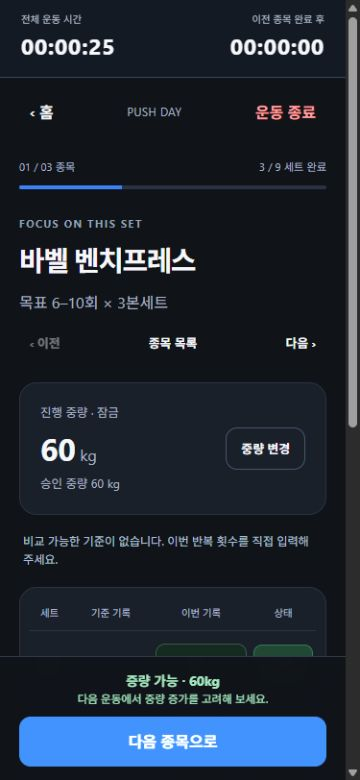

# Task 004 후속 — iPhone 피드백 및 UX 개선

작성일: 2026-10-26 (Asia/Seoul). 사용자의 **Task 004 수정 전 iPhone Safari 피드백**을 현재 소스에 반영했다. 아래 브라우저 검증은 데스크톱 Chromium이며, 최신 코드의 실제 iPhone 최종 검증은 보류다.

## 다섯 피드백별 결과

| 피드백 | 기존 상태 | 이번 변경 | 검증 결과 |
| --- | --- | --- | --- |
| ① 글로벌 헤더·설정 탭 | 브랜드/설정 아이콘 헤더와 홈·루틴·기록 3탭. 설정은 App 내부에 존재 | 공통 헤더 제거, 홈·루틴·기록·설정 4탭. 독립 `SettingsScreen`의 휴식시간/로컬 저장 안내/서버 진단 메뉴로 구성. 화면 제목과 운동 타이머 유지 | DOM에서 헤더 없음, 4탭/활성 표시 확인. 375/390/430px 터치 영역 모두 44×44 이상. 휴식 120→125초 저장 및 재로드 유지. 기존 Health 패널의 재확인/실패 안내 유지 |
| ② LAN UUID 오류 | Task 004에서 native 우선/getRandomValues UUID v4 fallback과 회귀 테스트가 이미 구현됨 | **추가 수정 없음**. 기존 코드·테스트를 보존하고 재검증 | 실제 LAN HTTP 포트 3024에서 운동 시작→워밍업→세트 완료→새로고침/이어하기 통과. 새 루틴/사용자 종목 생성도 정상. API 미지원 자동 테스트 유지·통과 |
| ③ 오늘만 선택 라벨 | override 클릭 이력이 있으면 기본으로 돌아와도 오늘만 선택 | 선택 ID와 오늘 기본 ID를 비교하는 `RoutineSelectionBadge`. 선택 없음은 REST DAY, 기본이 없는 날의 수동 선택은 오늘만 선택 | DOM `PUSH 기본 → PULL 오늘만 → PUSH 기본` 즉시 복귀. 자동 테스트에서 휴식일/선택 해제 및 주간 스케줄 불변 확인 |
| ④ 증량 안내 가시성 | 세트 카드 아래 안내만 있어 스크롤 위치에 따라 놓침 | 기존 `recommendation`을 재사용해 완료 종목의 고정 CTA 바로 위에 짧은 증량 가능 안내. 다음 종목/전체 종료 모두 적용 | 실제 10/10/10에서 표시. 중간 세트, 완료 취소, 마지막 9회에서는 숨김. 최종 종목 10/10/10에서도 종료 CTA 위 표시. 임시/혼합 중량·세트 확장 제외 자동 테스트 통과. 승인 중량 자동 변경 없음 |
| ⑤ 이어하기 상태 | 전체 시간·완료 수만 있고 워밍업 외 상태 구분 부족 | `ResumeWorkoutCard`로 준비운동 중/운동 중/휴식 중/종목 전환 중/운동 종료 대기 표시. 유효한 휴식·전환에만 타이머 한 줄 표시 | 다섯 상태 모두 실제 DOM 확인. 125초 휴식+30초→홈 2:35→새로고침 2:34. 종목 이동 후 전환 유지와 다음 세트 후 휴식 전환 확인 |

## 변경 파일과 설계

- `src/App.tsx`: 공통 헤더 제거, 설정 탭 연결, 기본 루틴 ID 비교, 이어하기 카드 연결. 기존 세션 생성/종료·저장 처리는 유지.
- `src/App.css`: 4열 탭, 56px 탭 높이, 헤더 제거 후 페이지 상단 Safe Area, 짧은 증량 안내/설정 메뉴/이어하기 타이머 스타일. Task 004 긴 종목명 CSS 보존.
- `src/features/settings/SettingsScreen.tsx` 신규: 구현된 메뉴만 제공하고 하위 화면에서 설정 목록으로 복귀. 기존 휴식시간 입력 검증/저장을 옮기고 Health 패널은 진단 메뉴 진입 시 표시한다. 미래 기능용 가짜 메뉴는 추가하지 않았다.
- `src/features/routine/RoutineSelectionBadge.tsx` 신규: 현재 선택/기본 ID에 따른 표시 책임 분리.
- `src/features/workout/ResumeWorkoutCard.tsx` 신규: 기존 `summary`, `resolveWorkoutTimer`, `hasIncompleteSets`, `formatDuration`에서 표시를 파생한다. 만료된 휴식은 운동 중, 전체 완료는 종료 대기를 우선한다. 다른 종목을 보고 있어도 세션의 유효한 휴식을 나타낸다.
- `src/features/workout/WorkoutScreen.tsx`: 기존 판정이 increase이며 현재 종목이 모두 완료됐을 때 고정 안내 표시. 추가 확인창·자동 증량·새 타이머는 없다.
- `tests/components.test.mjs`: 기존 내비게이션 기대값 갱신, 라벨/설정 메뉴/이어하기/증량 배너 회귀 8개 추가.
- `docs/product/requirements.md`, `docs/product/ui-ux.md`: 4탭/설정 메뉴/라벨/고정 안내/이어하기 상태 계약을 현재 화면과 일치시킴.
- 이 보고서와 `docs/tasks/evidence/task-004-followup-*`: 후속 검증 증거. 이전 Task 004 보고서·체크리스트·증거·저장 fixture는 변경하지 않았다.

저장 스키마, 저장 키, UUID 구현, 도메인 판정, 타이머 상태 전이, `useWorkout`은 변경하지 않았다. 기존 시각 기반 화면 갱신을 그대로 사용하며 새 interval·타이머 생성·매초 localStorage 저장을 추가하지 않았다. Settings 분리는 기존 화면 코드의 이동이며 새 아키텍처/의존성 도입이 아니다.

## 검증 결과

| 명령 | 결과 |
| --- | --- |
| `npm test` | **68/68 통과**, 실패/skip 없음. 기존 60 + 컴포넌트 회귀 8. Health 11, 도메인/저장 37, React SSR 20 |
| `npm run lint` | 통과 |
| `node node_modules/typescript/bin/tsc -b` | 통과 |
| `npm run build` | 통과. Vite 8.3.5, JS gzip 82.92kB / CSS gzip 3.81kB |
| `git diff --check` | 두 저장소 통과. LF→CRLF 안내만 있으며 공백 오류 없음 |

첫 검사에서는 추가한 탭 개수 테스트가 `<button `만 세어 속성 없는 버튼을 놓쳐 67/68이었다. HTML에서 속성 없는 button도 세도록 검사식을 수정한 뒤 컴포넌트 20/20 및 전체 68/68을 재확인했다. 요구사항이나 검사를 비활성화하지 않았다.

### 실제 브라우저 범위

실사용 포트 3000과 이전 시험 origin에서 분리한 **LAN HTTP 3024의 프로덕션 빌드**에서 DOM 클릭/입력/새로고침을 수행했다. 기존 사용자 origin의 데이터를 삭제하거나 초기화하지 않았다.

1. 기본→임시→기본 루틴 선택, 홈 헤더 제거, 4개 탭과 설정 활성 상태 확인.
2. 설정 휴식 125초 저장/재로드 복원, 로컬 저장 안내, 기존 Health 진단 메뉴 진입 확인. 백엔드는 범위 밖이라 실행하지 않았으며 진단은 예상된 HTTP 502/연결 실패를 표시했다. API 성공/실패 처리는 기존 자동 테스트가 통과했다.
3. 운동 시작→워밍업→홈 준비운동 중→새로고침→본세트→홈 운동 중→행 완료→휴식→+30초→홈 휴식 중→재로드/이어하기.
4. 하단 중간 세트 완료에는 증량 배너 없음. 첫 종목 10/10/10에서 고정 증량 안내, 홈 전환 상태 확인. 완료 취소로 안내 제거, 9회 재완료에서도 숨김. 다음 종목 이동/재로드에도 전환 시각 유지, 첫 세트 완료 후 휴식으로 전환.
5. 전체 9/9 완료에서 종료 안내·고정 증량 배너와 홈 종료 대기. 직접 종료 전 기록 탭은 비어 있음. 직접 종료 후에만 9/9·2,790kg 이력 생성, 새로고침 후 유지.
6. 긴 영문 종목명과 12.5kg의 별도 1세트 루틴 생성/완료, 종료 CTA의 증량 안내와 홈 복원 확인. 375px, scrollY 678에서도 타이머 top 0과 안내/CTA 고정 유지.

모바일 실측 결과(세로 스크롤바 제외):

| 뷰포트 | 문서 client/scroll 너비 | 탭 하나의 터치 크기 | 증량 안내 높이 | 안내 bottom / CTA top |
| --- | --- | --- | --- | --- |
| 375×812 | 360/360 | 80×56 | 약 38px | 736 / 746 |
| 390×844 | 375/375 | 83.75×56 | 약 38px | 768 / 778 |
| 430×932 | 415/415 | 93.75×56 | 약 38px | 856 / 866 |

CTA 높이는 52px로 유지했고 안내와 10px 간격이 있다. 가로 넘침이나 안내/버튼 겹침은 없었다. 일반 앱에서 수집한 console error/warn은 없었다. Health 진단 시 서버 로그의 `ECONNREFUSED 127.0.0.1:8080`은 백엔드 미실행에 따른 예상 결과다.

**실제 iPhone Safari, iOS 키보드 자동 확대/가림, Safe Area 실제 값, 앱 전환·화면 잠금은 이번 후속에서 미검증**이다. CSS/데스크톱 뷰포트 확인을 실기기 성공으로 판정하지 않는다. 서버 동기화·백업·설치형 PWA·Service Worker·오프라인 재실행은 추가하지 않았다.

## Git·보호·프로세스 정리

- 프론트엔드 시작: `main`, HEAD `3664af4 fix: refine workout flow and rest timer transitions`. 기존 Task 004 추적 변경 3개(`App.css`, `model.ts`, `workout.test.mjs`)와 신규 문서/증거/fixture 5개가 있었다.
- 백엔드 시작/종료: `main`, HEAD `db69c83 docs: Refine agent autonomy rules`, clean. 변경/빌드/테스트를 수행하지 않았다.
- 이번 후속만의 기존 파일 차이: 6개, **177줄 추가/31줄 제거**. 새 UI 컴포넌트 3개, 후속 보고서 1개, 증거 3개를 추가했다. 전체 Git diff의 8개 추적 변경(213+/33-)에는 이전 Task 004 수정도 포함된다.
- 이전 UUID 코드/테스트와 문서·수동 QA·증거·fixture는 시작 스냅샷과 SHA-256 일치를 확인했다. 이전 긴 이름 CSS도 그대로 유지했다.
- `vite.config.ts`의 `host: true` 유지. 파일 SHA-256은 시작/종료 모두 `C19FFDF9DEFFB6E8E11B66519958D0AC59B6827A2299FD12B81C0C3DD1547B78`이다.
- 패키지/lockfile, API, DB, 백엔드, 하네스 규칙 변경 없음. 무관한 사용자 변경을 되돌리지 않았다.
- 검증 preview 세션 `6981`을 Ctrl+C로 종료하고 `netstat -ano -p tcp`에 3024 항목이 없음을 확인했다. 자동 테스트/빌드는 종료됐고 브라우저 탭/viewport override도 정리했다. 사용자의 서버는 종료하지 않았다.
- 제품 변경에 추가 사전 승인 불필요, 승인 대기/보류 작업 없음. 로컬 LAN 검증 서버 실행 권한은 승인됐다. **Commit / Push / 배포 모두 미수행.**

종료 Git 상태(이전 작업 포함):

```text
 M docs/product/requirements.md
 M docs/product/ui-ux.md
 M src/App.css
 M src/App.tsx
 M src/features/workout/WorkoutScreen.tsx
 M src/features/workout/model.ts
 M tests/components.test.mjs
 M tests/workout.test.mjs
?? docs/tasks/evidence/task-004-browser-checks.json
?? docs/tasks/evidence/task-004-followup-browser-checks.json
?? docs/tasks/evidence/task-004-followup-home.jpg
?? docs/tasks/evidence/task-004-followup-increase.jpg
?? docs/tasks/evidence/task-004-mobile.jpg
?? docs/tasks/task-004-followup-ux-report.md
?? docs/tasks/task-004-iphone-manual-checklist.md
?? docs/tasks/task-004-iphone-usability-report.md
?? src/features/routine/RoutineSelectionBadge.tsx
?? src/features/settings/SettingsScreen.tsx
?? src/features/workout/ResumeWorkoutCard.tsx
?? tests/fixtures/task004-storage.html
```

## 최신 iPhone 코드에서 확인할 최소 시나리오

PC에서 `npm run dev`를 실행하고 같은 신뢰 Wi-Fi의 Safari에서 기존 `http://<실제 PC LAN IP>:3000` 주소를 새로고침한다. IP는 `ipconfig`로 확인하며 사이트 데이터는 지우지 않는다. 이번 검증용 서버는 종료했다.

1. 브랜드 헤더가 사라졌는지, 하단 홈/루틴/기록/설정 4개 탭과 설정의 휴식/진단 메뉴가 정상인지 확인한다.
2. 오늘 기본 루틴→다른 루틴→기본 루틴으로 선택해 라벨이 기본→오늘만→기본으로 돌아오는지 확인한다.
3. 운동 시작→워밍업에서 홈 복귀→이어하기. 본세트 완료/휴식/+30초 뒤 홈과 새로고침에서 상태와 남은 시간이 유지되는지 확인한다.
4. 같은 승인 중량에서 목표 상한을 모든 세트 달성하고, 다음 종목 버튼 바로 위의 증량 안내가 스크롤 없이 보이는지 확인한다. 완료 취소/미달 시 사라지고 중량이 자동 변경되지 않아야 한다.
5. 키보드가 열린 입력과 키보드를 닫은 완료 상태에서 CTA·안내·노치/홈 인디케이터 겹침을 확인한다. 전체 완료 시 홈 종료 대기 및 종료 CTA 위 안내, 직접 종료 후에만 이력 저장을 확인한다.

실기기에서 입력 장애/유실/가림이 있으면 기기·iOS·Safari 여부와 순서를 기록해 공유한다. 실기기 최종 판정은 결과를 받은 뒤 별도로 수행한다. 이전 [Task 004 수동 기록지](task-004-iphone-manual-checklist.md)는 보존했다.

## 증거

- [후속 DOM 확인 및 레이아웃 JSON](evidence/task-004-followup-browser-checks.json)
- [헤더 없는 홈과 4개 탭](evidence/task-004-followup-home.jpg)


