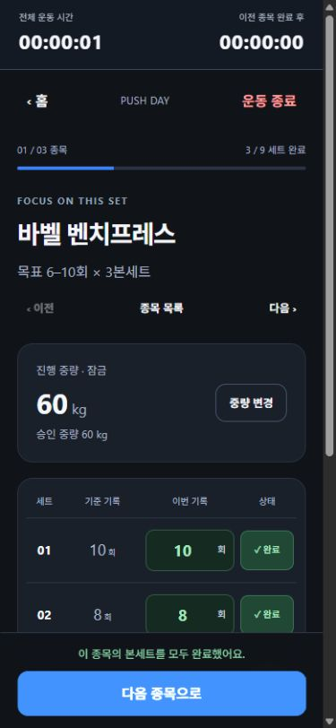

# Task 004 — iPhone 사용성 및 로컬 기록 안정성 검증 보고서

작성일: 2026-10-26 (Asia/Seoul).

**판정: 코드 수정과 접근 가능한 자동·데스크톱 DOM 검증 완료. 실제 iPhone Safari 최종 검증은 보류.** 브라우저 전체 오프라인 차단과 OS의 실제 백그라운드 제한은 아래와 같이 미검증 범위를 남긴다.

## 실제 변경

재현한 작은 결함 두 종류를 수정했다. 백엔드, API, 저장 키 `overload.core.v1`, schema version 1, 타이머·기준 기록 정책, 의존성, `vite.config.ts`는 변경하지 않았다.

| 파일 | 변경 이유 |
| --- | --- |
| `src/features/workout/model.ts` | LAN HTTP에서 `crypto.randomUUID`가 없어 운동을 시작하지 못하는 결함 수정. 사용 가능한 경우 기존 API를 쓰고, 없으면 `crypto.getRandomValues`로 같은 UUID v4 문자열 형식을 생성 |
| `src/App.css` | 공백 없는 긴 종목명으로 홈/종목 추가 버튼이 가로로 넘치는 결함 수정. 그리드 이름 열을 축소 가능하게 하고 종목명/선택·목록 버튼 줄바꿈 보완 |
| `tests/workout.test.mjs` | 기본 UUID 경로와 API 부재 시 UUID 형식·중복·운동 생성/저장/복원 회귀 테스트 2개 추가 |
| `tests/fixtures/task004-storage.html` | 실제 React 앱에서 저장 쓰기 실패/재시도/손상/버전 불일치를 검증하는 전용 시험 fixture. 일반 앱 진입점에 연결하지 않음 |
| `docs/tasks/task-004-iphone-manual-checklist.md` | 제공된 체크리스트를 접속법·키보드·잠금·복원·종목 전환 등 23개 실기기 기록 항목으로 정리 |
| 이 보고서, `docs/tasks/evidence/task-004-browser-checks.json`, `docs/tasks/evidence/task-004-mobile.jpg` | 수행 결과, DOM 측정 및 화면 증거 |

## 시나리오별 결과

내장 데스크톱 Chromium에서 실제 클릭·입력·새로고침·DOM 읽기를 수행했다. SSR 검사는 브라우저 검사와 별개다. 실제 iPhone이나 Safari/WebKit을 실행했다고 간주하지 않는다.

| 시나리오 | 방식 | 결과와 근거 |
| --- | --- | --- |
| 기준 상태 | npm/TypeScript/빌드 | 시작 시 58/58, lint·타입·build·양쪽 diff check 통과 |
| 요일 루틴·수동 선택·워밍업 | 자동 + DOM | 월요일 PUSH 기본 선택, PULL 수동 선택, PUSH 시작→워밍업. 준비운동 입력/실적 없음. 새로고침/이어하기 후 단계와 전체 시간 유지 |
| 초안·입력 검증 | 자동 + DOM | `9/8/빈 값` 초안 복원. 빈 값과 `1.5` 완료 시 오류, 실적 미생성. 정수로 재수정 가능 |
| 중간 세트·휴식 | 자동 + DOM | 행 1세트 완료→2분 휴식, `+30초`→2분30초, 새로고침 후 2분29초. 하단 2세트 완료도 동일한 휴식 규칙 |
| 마지막 세트·종목 전환 | 자동 + DOM | 하단/행 마지막 세트 모두 해당 종목 유지, 경과시간과 다음 CTA, 휴식 없음. 이동 전/후 각각 새로고침해 선택 종목·완료·경과시간 복원. `00:00:00 → 00:00:01`로 이어짐 |
| 수동 탐색·완료 취소 | 자동 + DOM | 다음 종목 첫 완료로 휴식 전환, 이전 종목 확인 후 복귀해 2분→1분59초 유지. 완료 취소 시 6/9→5/9, 전환 타이머 제거, 수정/재완료 가능 |
| 오늘만/진행 중량 | 자동 + DOM | 22.5kg 오늘만 완료 후 승인 20kg 유지. 진행 중량 25kg로 변경해도 첫 실제 22.5kg 보존. 종료 이력에도 일시 변경 표시 |
| 전체 완료·명시적 종료 | 자동 + DOM | 9/9에서 종료 전 새로고침/이어하기 가능, 기록 목록 비어 있음. 직접 종료 후 9/9·2,530kg 이력 생성 및 재로드 후 유지 |
| 수정 빌드 재검증 | 자동 + DOM | 긴 종목명·12.5kg 루틴 3/3 종료 후 337.5kg 이력. 기존 PUSH 기준 10/8/7 재사용 및 마지막 세트의 다음 CTA 재확인 |
| 기준 기록·원본 경계 | 자동 | `10/9/7 → 10/8/6 → 10/9/8`, 실제 이력 보존, 임시 중량/원본 루틴/세션 편집 경계 기존 테스트 통과. 이 세 세션 전체를 브라우저에서 반복하지는 않음 |
| 저장 실패/재시도 | 전용 fixture + DOM | 저장소 값은 9, 화면 입력은 12로 유지하며 실패 경고. 쓰기 허용→다시 저장→저장소도 12, 재로드 후 12 복원 |
| 종료 시 저장 실패 | 전용 fixture + DOM | 저장소의 기존 활성 세션 유지, 화면은 `운동 기록 요약`·저장 상태 확인 안내. 성공으로 표시하지 않음. 재시도 후 이력 1개와 `운동 기록 저장 완료` |
| 손상/버전 불일치 | 자동 + 전용 fixture DOM | `{broken`, version 2 각각 오류 안내와 fieldset disabled. 원문 변경 없음(`rawUnchanged: true`), 자동 초기화/덮어쓰기 없음 |
| 다중 탭 충돌 | 실제 두 탭 DOM | 두 번째 탭의 운동 시작 저장 후 첫 탭에 충돌 안내와 편집 차단. 자동 병합/복구 지원으로 해석하지 않음 |
| 모바일 레이아웃 | 375×812, 390×844, 430×932 DOM | 긴 종목명 홈·추가 화면에서 최종 `scrollWidth === clientWidth`. 운동 화면·모달·소수 중량 확인. 본세트 입력 18.4px, 중량 입력 16px |
| 스크롤 고정 | DOM + 화면 | 375×812에서 scrollY 658에도 타이머 top 0, CTA bottom 812. iOS 키보드·Safe Area 실제 값은 미확인 |
| 네트워크 요청 실패 중 기록 | 로컬 서버 중단 대체 시험 | 이미 로드된 화면에서 Health 요청이 연결 실패함을 확인하고, 1세트 완료 및 2세트 초안 9 입력. 서버 재개·재로드 후 완료와 초안 유지 |
| 브라우저 전체 Offline 차단 | 미실행 | 내장 도구에 네트워크 차단 API가 없어 위 서버 중단으로 대체. Edge 네이티브 접근은 최소화된 창을 선택하지 못해 수행하지 않음. Wi-Fi/셀룰러 단절과 같다고 판정하지 않음 |
| 실제 탭 백그라운드 제한 | 부분 확인 | 새로고침·화면 재진입·여러 검사 탭 작업 전후 시간 표시 및 시각 기반 모델은 확인. 내장 브라우저가 실제 hidden/throttling 상태인지 입증하지 못했으므로 백그라운드 제한·화면 잠금 복귀는 미검증 |
| 실제 iPhone Safari | 미실행·보류 | [수동 체크리스트](task-004-iphone-manual-checklist.md) 결과를 받은 뒤 별도 판정 |

레이아웃 최종 측정(스크롤바를 제외한 clientWidth 기준):

| innerWidth×innerHeight | 홈 client/scroll | 긴 이름 추가 화면 client/scroll | 결과 |
| --- | --- | --- | --- |
| 375×812 | 360/360 | 360/360 | 가로 넘침 없음 |
| 390×844 | 375/375 | 375/375 | 가로 넘침 없음 |
| 430×932 | 415/415 | 415/415 | 가로 넘침 없음 |

초기 브라우저 배율·다중 탭 뷰포트 대상 확인 중 요청 크기와 실제 크기가 다른 샘플이 있었다. 증거 JSON의 초기 체크 이름만으로 크기를 판단하지 않으며, **`layoutResults`의 최종 실측값**을 위 표의 근거로 사용한다.

## 발견 결함과 수정 근거

### 1. LAN HTTP에서 운동 시작 불가 — 수정

1. 실사용 포트 3000과 분리한 LAN HTTP 포트 3015로 현재 Vite 앱 접속.
2. 홈의 `운동 시작` 클릭 시 `crypto.randomUUID is not a function`이 표시되고 워밍업에 진입하지 못함.
3. `newId()`가 해당 API만 직접 호출하는 것이 원인. 로컬 루프백 주소에서는 드러나지 않았다.
4. native UUID 우선 + getRandomValues 기반 v4 대체 경로 추가. 저장 스키마/ID 의미/보안 설정은 변경하지 않음.
5. 같은 LAN 주소에서 시작→워밍업→1세트 완료→새로고침/이어하기가 정상. 자동 테스트는 native 경로 및 대체 경로의 UUID 256개 형식/중복과 세션 생성·저장·복원을 확인.

이는 데스크톱 Chromium의 동일한 HTTP 접속 조건에서 재현/수정한 결과다. 실제 iPhone 결과는 M04로 확인해야 한다.

### 2. 공백 없는 긴 종목명 가로 넘침 — 수정

`Task004SuperLongExerciseNameWithoutSpacesInclineDumbbellPress`를 사용자 종목으로 추가하면 홈 그리드와 추가 버튼이 가로로 넘쳤다. 375px 실제 뷰포트에서도 문서 scrollWidth가 532px였다(추가 버튼은 450px 화면에서 595px). 이름 열의 기본 최소 크기와 줄바꿈되지 않는 버튼 텍스트가 원인이다.

그리드 열을 `minmax(0, 1fr)`로 조정하고 긴 이름이 줄바꿈되도록 보완했다. 최종 빌드에서 위 세 크기의 홈/선택 화면을 재검증했다. CSS 문자열만 비교하는 테스트를 추가하는 대신 실제 DOM 너비와 모달·화면 결과를 회귀 증거로 남겼다.

### 검증 환경 및 도구 오류

- 최초 Vite/preview는 설치된 Console Ninja가 로컬 3119 포트에 연결하다 샌드박스 `EACCES`로 종료했다. 실행 환경 권한 조정 후 정상 기동했으며 제품 코드를 변경해 우회하지 않았다.
- 확인창 처리 중 브라우저 클릭/CDP 시간 초과가 있었다. 새 상태를 읽거나 Escape로 도구를 복구하고 이미 반영된 상태를 확인했다. 중복 완료/종료를 하지 않았다. 앱 결함으로 분류하지 않았다.
- 종료 후 LAN 포트 능동 연결 검사는 timeout이어서 단독 종료 근거로 사용하지 않았다. 실행 세션 종료와 `netstat`에서 세 시험 포트가 모두 사라진 것으로 종료를 확인했다.
- 일반 앱 DOM 검사에서 수집된 console error/warn은 없었다. 입력 검증 경고와 의도적으로 발생시킨 저장/네트워크 실패는 예상 결과다.

## 저장 시험 재현법과 한계

```powershell
npm run dev -- --host 127.0.0.1 --port 3016 --strictPort
```

전용 시험 주소 `http://127.0.0.1:3016/tests/fixtures/task004-storage.html?scenario=failure`에서 이어하기→2세트 입력 변경→`QA 저장값 확인`으로 저장/화면 차이를 확인한다. `QA 쓰기 허용`→앱의 `다시 저장`으로 복구한다. `scenario=corrupt`, `scenario=version`은 손상/버전 불일치 보호를 확인한다.

fixture는 `127.0.0.1:3016` 이외의 origin에서 실행을 거부하며, fixture 표식이 없는 기존 앱 데이터가 있으면 덮어쓰지 않고 중단한다. 같은 전용 origin에서 시나리오를 바꾸면 **이 fixture가 만든 시험 데이터**를 교체한다. 다중 탭 검사는 같은 origin의 `/`를 두 번째 탭에 열어 실제 저장 이벤트로 수행했다. 일반 제품 빌드에 fixture는 포함하지 않는다.

시험한 origin은 루프백 3014(실제 빌드), 별도 LAN 포트 3015(HTTP UUID), 루프백 3016(저장 fixture)이다. 기존 사용자 origin/사이트 데이터는 삭제·초기화하지 않았다.

현재 미구현인 IndexedDB, 서버 동기화·전송 자동 재시도, 서버 백업·복구, Service Worker, 오프라인 새로고침/앱 재실행, 설치형 PWA, 푸시를 제품 결함이나 완료 기능으로 판정하지 않는다. localStorage 장애 중 저장되지 않은 메모리 입력은 재로드 시 유실될 수 있다는 기존 경고가 정상 표시됨을 확인했다. 로컬 저장을 영구 백업으로 표현하지 않는다.

## 최종 검증

| 명령 | 결과 |
| --- | --- |
| `npm test` | **60/60 통과**: Health 11 + 도메인/저장 37 + React SSR 12. 기준 58개에서 UUID 회귀 2개 추가 |
| `npm run lint` | 통과 |
| `node node_modules/typescript/bin/tsc -b` | 통과 |
| `npm run build` | 통과. Vite 8.3.5, JS gzip 82.67kB / CSS gzip 3.83kB |
| `git diff --check` | 양쪽 저장소 통과. Windows LF→CRLF 안내만 있었고 공백 오류 없음 |

자동 테스트 실패는 없다. 백엔드 테스트/빌드는 변경 범위 밖이라 실행하지 않았다. 실제 iPhone·iOS 키보드·Safari Safe Area·잠금 복귀·브라우저 전체 네트워크 차단은 성공으로 보고하지 않는다.

서버 세션 25355(첫 preview), 58843(재개 preview), 44656(LAN Vite), 89390(fixture Vite)를 Ctrl+C로 종료했다. 초기 실행 실패 프로세스와 자동 검사도 종료됐다. `netstat -ano -p tcp`에서 3014/3015/3016 항목이 없음을 확인했다. 사용자가 시작한 프로세스는 종료하지 않았다. 생성한 브라우저 탭과 임시 viewport override도 정리했다.

## Git 및 승인 상태

| 저장소 | 시작 브랜치·최신 커밋 | 시작 상태 | 종료 상태 |
| --- | --- | --- | --- |
| overload-server | main · `db69c83 docs: Refine agent autonomy rules` | clean | clean, 변경 없음 |
| overload-pwa | main · `3664af4 fix: refine workout flow and rest timer transitions` | clean | 아래 3개 추적 파일 수정 + 문서/증거/fixture 신규 |

```text
 M src/App.css
 M src/features/workout/model.ts
 M tests/workout.test.mjs
?? docs/tasks/evidence/
?? docs/tasks/task-004-iphone-manual-checklist.md
?? docs/tasks/task-004-iphone-usability-report.md
?? tests/fixtures/
```

추적 파일 diff: 3개, 36줄 추가/2줄 제거. 신규 파일은 위 변경 표를 참조한다. 다른 작업의 미커밋 파일은 없었으며 기존 host:true 설정을 유지했다.

**Commit / Push / 배포 미수행.** 제품 변경에 추가 사전 승인 필요 없음, 승인 대기 작업 없음. 검증 서버 실행의 환경 권한은 승인됐다. API/백엔드 연동 변경 필요 없음.

남은 작업은 실기기 체크리스트 수행 및 결과에 따른 iPhone QA 판정이다. 심각한 입력 장애나 기록 유실이 보고되면 우선 재현·수정한다.

## 사용자 실행 안내와 증거

PC에서 `npm run dev` 실행 후 같은 신뢰 Wi-Fi의 iPhone **Safari**로 `http://<PC의 실제 LAN IP>:3000`에 접속한다. IP는 `ipconfig`로 확인한다. 먼저 운동 시작, 숫자 키보드/하단 CTA, 마지막 세트와 종목 이동, 휴식 중 잠금·복귀, 새로고침 복원을 확인하고 [체크리스트](task-004-iphone-manual-checklist.md)의 P/F/N과 관찰 증상을 기록한다.

- [DOM 측정 및 저장 오류 검증 JSON](evidence/task-004-browser-checks.json)
- 최종 빌드 390×844, 종목 마지막 세트 완료 후 화면:


