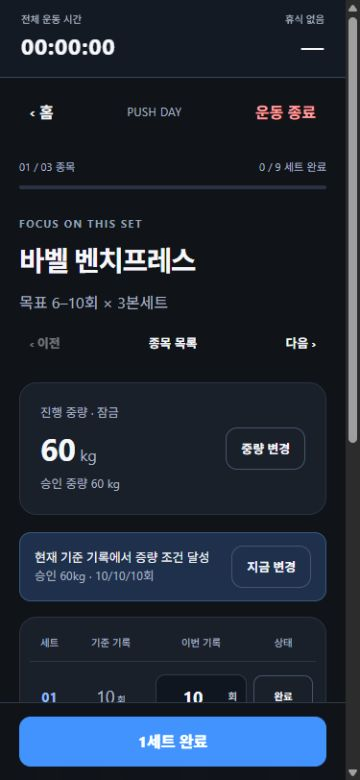

# Task 004 최종 후속 — 진행 중량 사후 변경과 증량 재안내

작성일: 2026-10-26 (Asia/Seoul).

**코드·자동 검사·데스크톱 LAN HTTP DOM 검증 완료. 최신 변경의 실제 iPhone Safari 검증은 미실행/보류.**

## 원래 문제와 결과

| 문제 | 최종 동작 |
| --- | --- |
| 승인 중량을 바꾸려면 운동 세션에 들어가야 함 | 기존 루틴 종목의 현재 진행 중량 옆 `변경`에서 소수 kg 입력. `루틴 저장`을 눌러야 승인됨. 입력/변경 취소/루틴 취소만으로는 반영하지 않음 |
| 증량을 보류하면 다음 운동에서 조건 달성 여부가 사라짐 | 현재 승인 중량·같은 배치/구성의 기준 기록이 모든 목표 상한을 충족하면 다음 세션에 근거와 `지금 변경` 표시. 무시하고 바로 세트를 기록할 수 있음 |
| 루틴 관리와 진행 중인 운동의 중량 경계 | 루틴 저장은 다음 새 세션에만 적용. 현재 세션의 중량·실제 기록·초안·타이머는 유지. 운동 화면의 기존 명시적 진행 중량 변경 결과도 루틴 관리에서 보임 |

기존 완료 직후의 고정 증량 안내, 한 종목 집중, 명시적 종료, 설정 탭, ID 기반 루틴 라벨, 이어하기 상태, UUID fallback, 긴 이름 처리는 유지했다.

## 설계 선택과 최종 UX 계약

### 루틴 관리의 명시적 승인

- 입력은 `RoutineEditor`의 별도 로컬 초안이다. 기존 `saveRoutine`에 선택적 진행 중량 변경 인자를 추가해 루틴 설정과 함께 한 번의 기존 update/save 경로로 반영한다.
- 중량은 기존 정책대로 0 이상의 유한한 숫자이며 소수 허용, 고정 증량 단위 없음. 빈 값/음수/무한대 등은 거부한다.
- 해당 루틴에 기존부터 존재하고 저장 결과에도 남는 배치 ID만 허용한다. 다른 루틴·존재하지 않는 배치의 중량을 함께 바꾸지 못한다. 오류면 일부만 반영하지 않고 저장 전체를 거부한다.
- 루틴 최초 중량과 현재 승인 중량은 분리한다. 기존 최초 중량, 다른 루틴, benchmark/history, 현재 활성 세션을 덮어쓰지 않는다.
- UI에 `루틴 저장을 눌러 새 중량을 승인합니다. 진행 중인 운동은 유지하고 다음 새 운동부터 적용합니다.`를 표시한다. 새 루틴의 최초 중량 입력과 기존 일정 교체 확인은 유지한다.

### 증량 결정 보류와 다음 운동 재안내

- 기존 `benchmarks`에서 `루틴 ID + 종목 배치 ID + 종목 정의 + 세트 수 + 최소/최대 횟수 + 승인 중량` 키를 조회한다. 기준 기록 길이가 예정 세트 수와 같고 각 횟수가 목표 상한 이상이어야 한다.
- 기준 생성/최고 기록 비교 정책은 변경하지 않았다. 기존에 비교 대상인 완결된 정상 세션의 단일 결과만 근거가 된다. 임시/혼합 중량·부분 완료·세션 구성 변경 등은 새로운 근거를 만들지 못한다. 세트별 이력 최대값을 합치지 않는다.
- `현재 기준 기록에서 증량 조건 달성`, `승인 60kg · 10/10/10회`처럼 현재 기준의 근거를 표시한다. 반드시 직전 운동이라고 주장하지 않는다. 직전 결과가 낮아도 더 좋은 기준 기록이 유지되면 안내도 유지한다.
- `지금 변경`은 기존 중량 변경 모달의 진행 중량 모드로 연결한다. 버튼을 누르거나 모달에서 값을 입력하기만 해서는 승인하지 않으며, 기존 확인 버튼으로 확정한다. 필수 선택창이나 매번 유지 확인은 없다.
- 오늘만 작업 중량이 50kg라도 승인 60kg에 대한 유효한 과거 기준은 **승인 60kg 근거**로 구분해 표시한다. 50kg를 승인하지 않는다. 오늘만/혼합 결과 자체를 새로운 기준으로 삼는 것과는 다르다.
- 승인 중량이 바뀌면 새 중량의 키로 다시 판단한다. 진행 세션이 옛 중량 스냅샷인 상태에서 루틴 관리의 승인 중량만 바뀌면 옛 중량의 재안내를 숨긴다. 옛 기록은 삭제하지 않는다. 새 중량에서 비교 가능한 기준을 달성하면 그 중량의 안내가 다시 가능하다.

`overload.core.v1`, version 1, 타입/저장 구조와 로더를 그대로 사용한다. 마이그레이션/새 저장 필드/새 의존성은 없다. 기존 저장 실패·재시도·다중 탭 편집 차단 경로를 우회하지 않았다.

## 변경 파일

| 파일 | 이번 변경 |
| --- | --- |
| `src/features/workout/model.ts` | `saveRoutine`의 배치별 명시적 승인/검증, 비교 가능한 `increaseBenchmark` 조회 |
| `src/features/routine/RoutineEditor.tsx` | 진행 중량 입력 초안·변경 취소·저장 승인 및 적용 시점 안내 |
| `src/App.tsx` | 루틴 저장 시 승인 초안을 기존 저장 액션으로 전달 |
| `src/features/workout/WorkoutScreen.tsx` | 기준 기록 재안내와 기존 중량 모달 연결 |
| `src/App.css` | 짧은 재안내 카드의 줄바꿈/버튼 배치 |
| `tests/workout.test.mjs` | 도메인·저장 회귀 7개 추가 |
| `tests/components.test.mjs` | 기존 루틴 편집 검사 보완, 재안내 표시/분리 회귀 2개 추가 |
| `docs/product/requirements.md`, `docs/product/ui-ux.md` | 최종 승인·재안내 계약과 Task 005 드랍세트 설계 대기 메모 |
| 이 보고서와 `docs/tasks/evidence/task-004-progression-*` 3개 | 후속 검증·화면 증거 |

이전 Task 003/004 보고서·수동 QA·증거·fixture는 보존했다.

## 테스트와 브라우저 수용 결과

| 수용 항목 | 확인 방식과 결과 |
| --- | --- |
| 비운동 상태 60→62.5kg 승인 | 실제 DOM: 초안 62.5 입력/취소 후 60 유지. 다시 저장 후 홈 62.5, 새로고침 후에도 유지. 빈 값은 오류로 차단 |
| 다른 루틴의 같은 종목 | 도메인/저장: 다른 루틴의 bench 배치 70kg 유지, 원래 최초 중량 60 및 이력·기준 불변 |
| 60kg 3×10 종료 후 다음 운동 | 실제 DOM: PUSH 9/9·2,850kg 저장 후 새 세션 진입. 승인 60kg·10/10/10 재안내, 세트는 0/9이고 완료 CTA 활성. 자동 완료/자동 증량 없음 |
| 확인/취소·오늘만 중량 | 실제 DOM: 지금 변경→62.5 입력→닫기 후 60 유지. 오늘만 50kg에서는 승인 60kg 근거만 표시. 기존 모달은 진행 중량 모드로 정상 연결 |
| 기준 유지·조합 오탐 방지 | 자동: 10/9/7→10/8/6은 기존 기준 유지, 별도 10/11/9와 9/10/11의 세트별 최고값 합성 없음. 더 낮은 직전 결과 뒤에도 과거 10/10/10 기준 재안내 |
| 중량/구성 변경 후 옛 안내 방지 | 자동+DOM: 루틴 승인 62.5 후 현재 옛 세션 재안내 제거. 다음 새 세션은 62.5·빈 초안·재안내 없음. 자동 테스트는 새 62.5 기준 달성 후 해당 중량 안내도 확인 |
| 비대상 결과 | 자동: 오늘만/혼합 중량/부분 완료/다른 종목 미완료 세션/확장 세트/세트 수·반복 범위·배치 변경/기준 배열 길이 불일치에는 잘못된 새 안내 없음 |
| 진행 세션 보호 | 실제 DOM: 60kg 1세트 10회 완료, 2세트 초안 9, 휴식 2:00에서 루틴 62.5 승인. 현재 세션 60kg·완료/9회 초안 유지, 휴식 1:58→재로드 1:57. 자동 테스트는 활성 객체 전체와 저장 round trip 동일성 확인 |
| 전체/부분 기록 보존 | 실제 DOM: 기존 9/9·2,850kg와 이후 1/9·600kg 이력이 모두 목록에 남음. 새 운동의 62.5 적용 확인. 운동 화면의 별도 65kg 승인도 루틴 관리에 반영됨 |
| LAN HTTP·기존 기능 | 별도 LAN HTTP 3034의 현재 프로덕션 빌드에서 시작/입력/종료/재로드 정상. UUID fallback과 기존 타이머·기준·이력 테스트 유지 |

데스크톱 Chromium **375×812**에서 루틴 변경 진입과 재안내 가시성을 DOM/스크린샷으로 확인했다. 문서 clientWidth/scrollWidth는 360/360으로 가로 넘침이 없었다. 재안내 높이는 72px, bottom 약 626px이며 고정 CTA top 731px와 겹치지 않았다. 신규 세션 완료 버튼은 사용 가능했다. 수집한 콘솔 error/warn은 없었다.

현재 세션의 저장 시각을 바꾸지 않은 채 휴식이 실제 경과만큼 줄어드는 것을 확인했다. OS의 실제 백그라운드 제한이나 iOS 키보드 동작을 시험한 것은 아니다.

### 최종 실행 결과

| 명령 | 결과 |
| --- | --- |
| `npm test` | **77/77 통과**, 실패/skip 없음. 기존 68 + 신규 9(도메인/저장 7, React SSR 2). Health 11 + 도메인/저장 44 + SSR 22 |
| `npm run lint` | 통과 |
| `node node_modules/typescript/bin/tsc -b` | 통과 |
| `npm run build` | 통과. Vite 8.3.5, JS gzip 83.32kB / CSS gzip 3.85kB |
| `git diff --check` | 두 저장소 통과. LF→CRLF 안내만 있으며 공백 오류 없음 |

검증 중 제품 오류/자동 검사 실패는 없었다. 미검증 범위는 **최신 코드의 실제 iPhone Safari·가상 키보드·Safe Area·화면 잠금**이다. 백엔드 테스트/빌드는 변경 범위 밖이라 실행하지 않았다.

## Git·기존 변경 보호·종료

- 시작: 프론트엔드 `main`, HEAD `3664af4 fix: refine workout flow and rest timer transitions`. 이전 Task 004 작업의 추적 수정 8개와 미추적 파일 12개가 있었다. 이번 작업 전에 별도 시작 스냅샷/해시를 저장했다.
- 이번 후속은 기존 파일 **9개, 228줄 추가/12줄 제거**와 보고서·증거 신규 4개다. 최종 Git diff는 이전 Task 004 작업도 포함하므로 이번 작업량과 혼동하지 않는다.
- 이전 UUID 생성, 운동 화면 중량 변경, 타이머 해석, recommendation, finish/기준 기록 생성 정책의 코드 구간이 시작 스냅샷과 동일함을 확인했다. 이전 도메인 테스트 원문도 유지하고 뒤에 회귀를 추가했다. 기존 CSS는 모든 줄을 보존하고 재안내 스타일만 추가했다.
- 변경 대상 외 스냅샷 파일은 SHA-256 일치. 기존 설정 화면·라벨·이어하기 컴포넌트, 수동 QA·보고서·증거·fixture, `storage.ts`, `types.ts`, `useWorkout.ts`, 패키지/lockfile 보존.
- `vite.config.ts`의 `host: true`를 변경하지 않았다. SHA-256 `C19FFDF9DEFFB6E8E11B66519958D0AC59B6827A2299FD12B81C0C3DD1547B78` 유지.
- 백엔드 시작/종료: `main`, HEAD `db69c83 docs: Refine agent autonomy rules`, clean. API/DB/서버 동기화/운영 설정 변경 없음.
- preview 세션 `93090`을 Ctrl+C로 종료하고 `netstat`에서 시험 포트 3034 항목이 없음을 확인했다. 자동 검사와 브라우저 탭/viewport override도 정리했다. 사용자 서버는 종료하지 않았다.
- 별도 제품 변경 승인 대기 없음. 검증 서버 실행의 환경 권한은 승인됐다. **Git Commit / Push / 배포 미수행.** 기존 사용자 origin/저장 데이터를 삭제하거나 초기화하지 않았다.

## Task 004 최종 계약과 Task 005 대기

Task 004는 일반 본세트의 실제 기록/최고 단일 세션 기준/승인 진행 중량을 독립적으로 유지한다. 사용자는 운동 중이나 루틴 관리에서 명시적으로 중량을 결정할 수 있고, 조건을 충족한 기준이 남아 있으면 다음 운동에서 결정을 보류한 채 재검토할 수 있다. 루틴 관리의 변경은 현재 세션을 소급 변경하지 않는다.

**Task 005 이후 드랍세트는 설계 대기 기능이며 현재는 일반 본세트 기준이다.** 미래 감량 구간을 정상 기준 기록과 섞지 않아야 한다는 메모만 제품 문서에 남겼다. 드랍세트/슈퍼세트/디로딩/차트의 구조나 기능을 구현하지 않았다.

## iPhone 최소 확인

PC에서 `npm run dev` 후 같은 신뢰 Wi-Fi의 Safari로 기존 `http://<실제 PC LAN IP>:3000`에 접속/새로고침한다. IP는 실제 `ipconfig` 결과로 확인하고 사이트 데이터는 삭제하지 않는다. 검증용 서버는 종료했다.

1. 루틴 편집→현재 진행 중량 변경→62.5 입력→취소/저장 차이와 재로드 유지 확인.
2. 진행 중인 세션에서 완료 세트/초안/휴식이 있는 상태로 루틴 승인 중량 변경→이어하기: 현재 기록은 그대로, 다음 새 세션만 새 중량인지 확인.
3. 같은 승인 중량에서 모든 예정 본세트의 목표 상한을 실제 달성해 종료→다음 운동: 근거 안내가 보이고 무시해도 기록 가능한지, 지금 변경/취소가 자동 승인하지 않는지 확인.
4. 키보드·노치·홈 인디케이터와 입력/고정 버튼/재안내 겹침 확인. 실제 iPhone 결과를 받은 뒤 최종 실기기 판정한다.

## 증거

- [DOM 검증 JSON](evidence/task-004-progression-browser-checks.json)
- [루틴의 진행 중량 변경 초안과 명시적 저장](evidence/task-004-progression-editor.jpg)

